# Architecture & API Reference

← [Back to README](README.md) · **English** | [Español](ARCHITECTURE.es.md)

Technical reference of Wedding Photo Manager: system overview, ER model, use-case/sequence/state diagrams, backend components, REST API, business rules, photo directories, technical decisions and repository layout.

## Contents

- [Architecture](#architecture)
- [API](#api)
- [Business rules](#business-rules)
- [Photo directories](#photo-directories)
- [Technical decisions](#technical-decisions)
- [Project structure](#project-structure)

## Architecture

### System overview

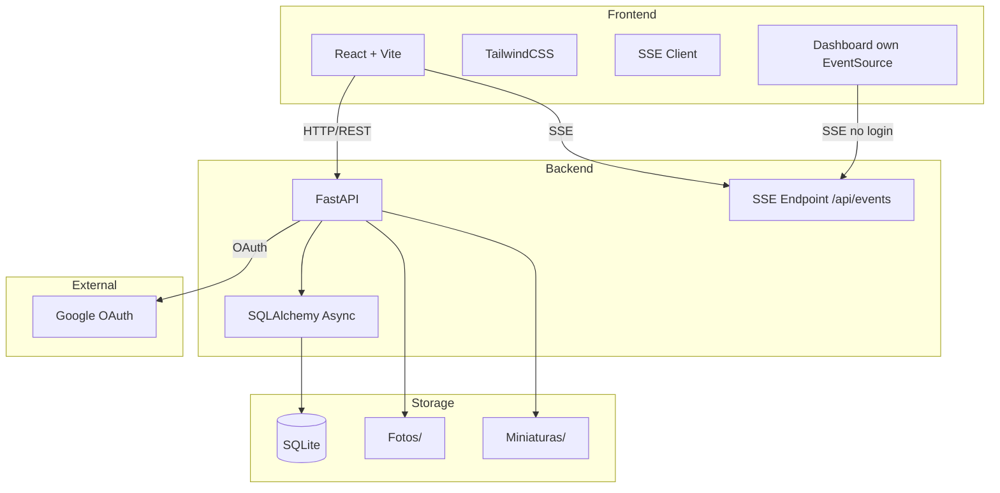

### Modules

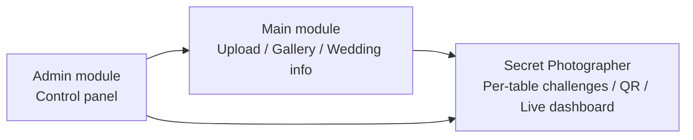

### Entity-Relationship (database)

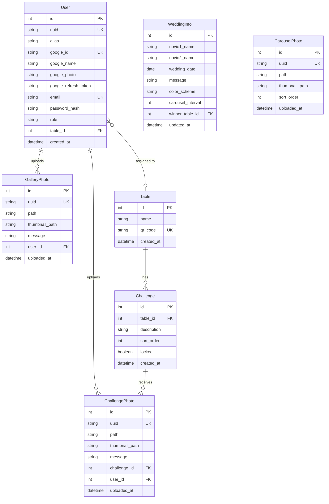

> `Table.name` is not unique (only `qr_code` is). Schema changes are applied with `Base.metadata.create_all` plus hand-written `ALTER TABLE` statements in the lifespan (no Alembic).

### Use cases

```mermaid
graph TB
    GUEST[Guest]
    COUPLE[Couple]
    GOOGLE[Google OAuth user]
    VIEWER[Guest viewer]

    subgraph "Main module"
        UC1[View wedding info]
        UC2[View carousel]
        UC3[Upload photo + message]
        UC4[View live gallery]
        UC5[Download photo]
    end

    subgraph "Secret Photographer"
        UC6[Scan table QR]
        UC7[View table challenges]
        UC8[Upload photo + message for a challenge]
        UC9[View my own photo per challenge]
        UC10[View public live dashboard]
    end

    subgraph "Admin"
        UC11[Manage carousel]
        UC12[Edit wedding info]
        UC13[Change colors]
        UC14[Manage tables]
        UC15[Create/edit/unlock challenges]
        UC16[Manage challenge photos]
        UC17[Pick winning table]
        UC18[Remove winning table]
        UC19[Moderate gallery]
        UC20[Manage users: rename, table, delete]
    end

    GUEST --> UC1
    GUEST --> UC2
    GUEST --> UC3
    GUEST --> UC4
    GUEST --> UC5
    GUEST --> UC6
    GUEST --> UC7
    GUEST --> UC8
    GUEST --> UC9

    VIEWER --> UC10

    COUPLE --> UC11
    COUPLE --> UC12
    COUPLE --> UC13
    COUPLE --> UC14
    COUPLE --> UC15
    COUPLE --> UC16
    COUPLE --> UC17
    COUPLE --> UC18
    COUPLE --> UC19
    COUPLE --> UC20

    GOOGLE -->|Recovers identity| UC3
    GOOGLE -->|Recovers identity| UC8
```

### Sequence diagrams

#### Guest access and photo upload

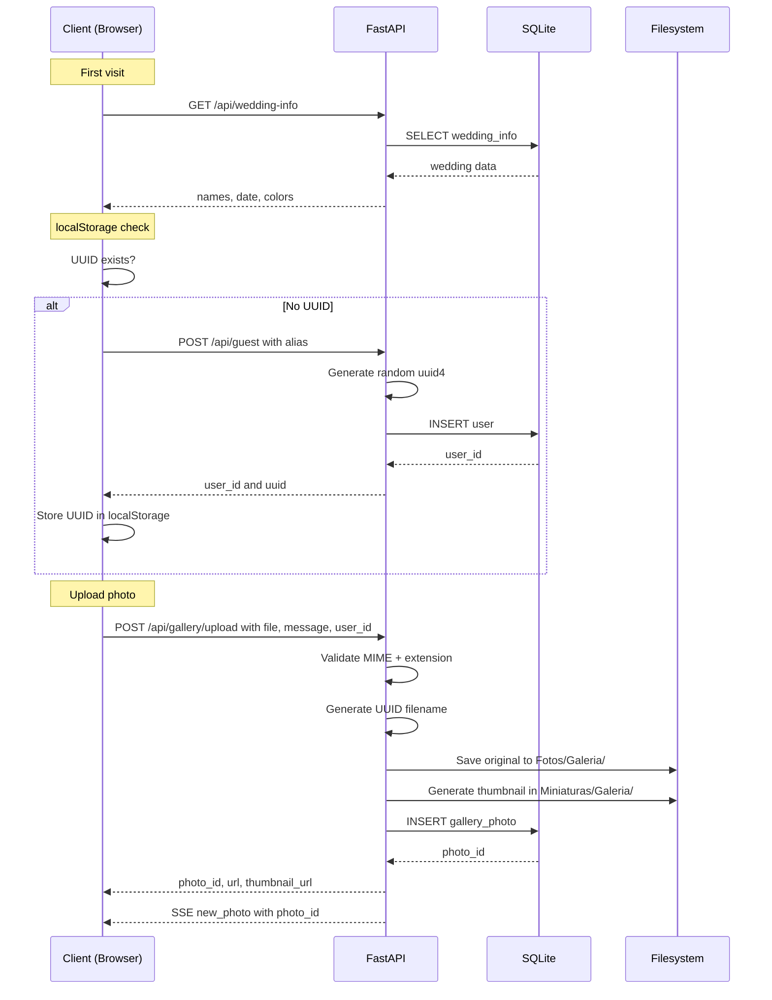

#### Secret Photographer (participant)

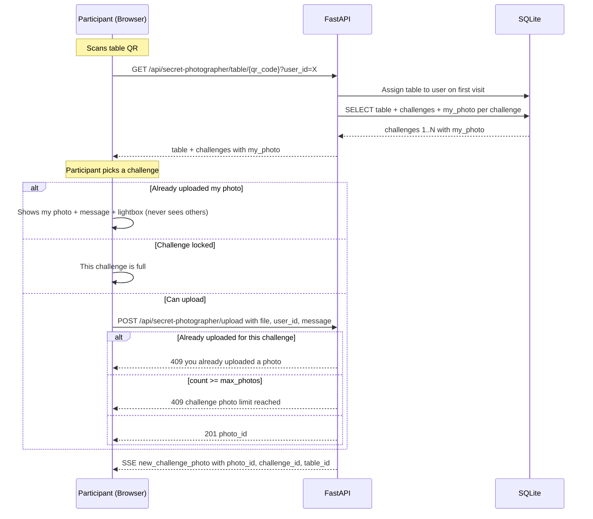

#### Public dashboard (viewer)

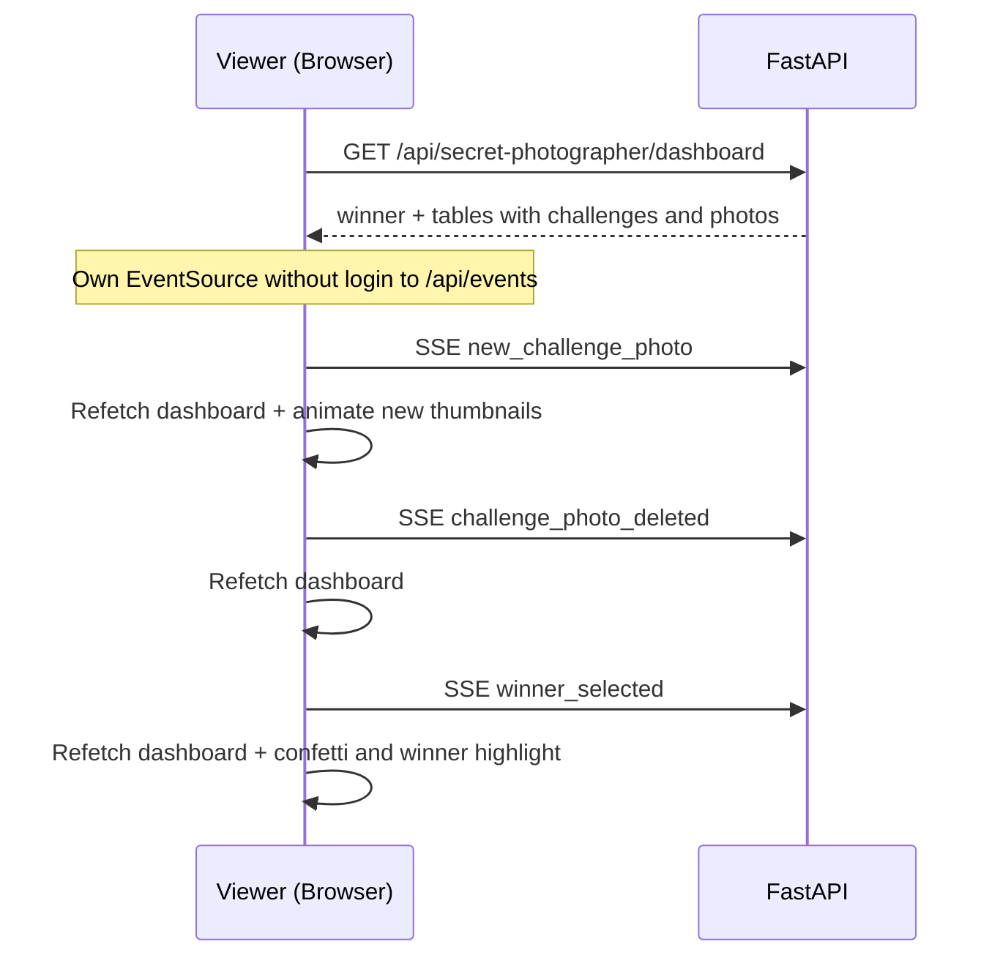

#### Winner selection (Admin)

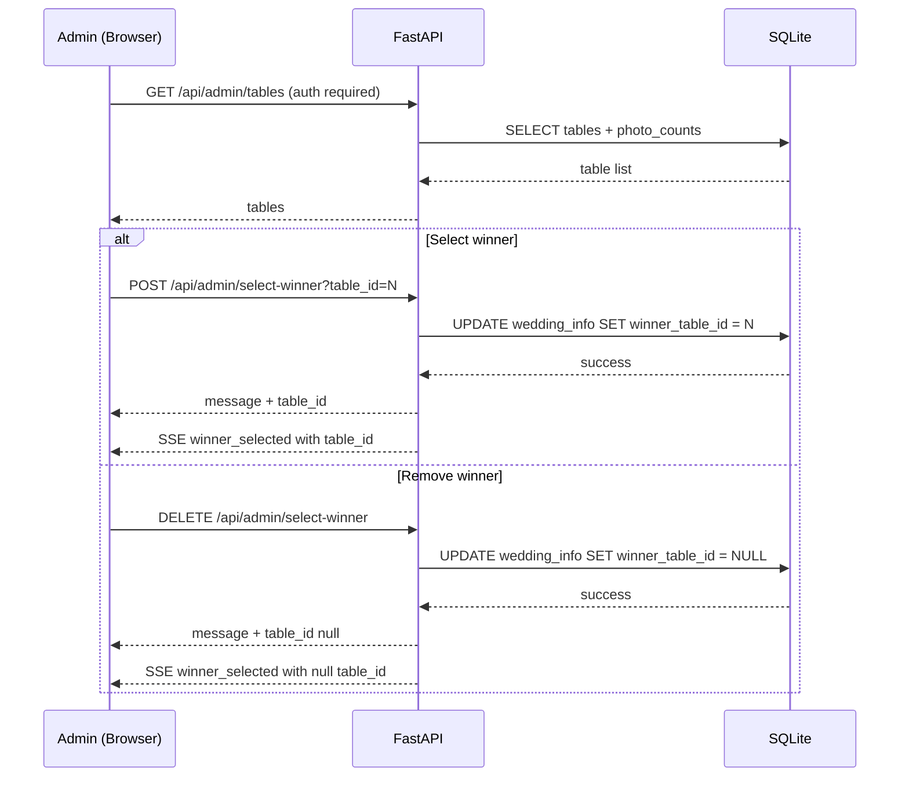

### State diagrams

#### Photo lifecycle

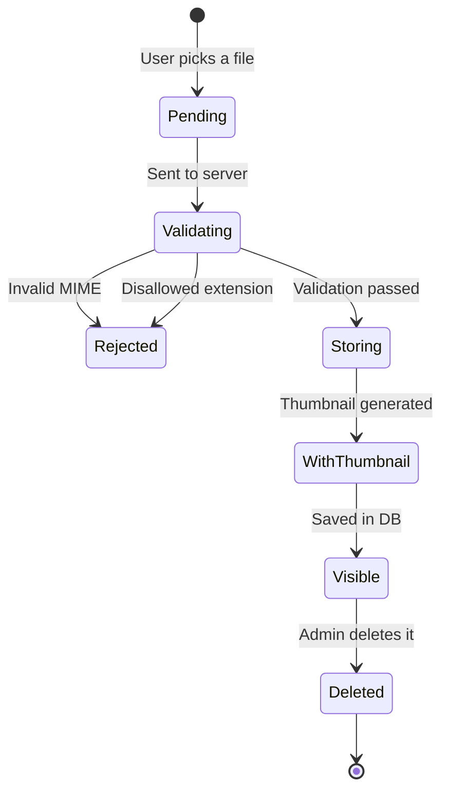

#### Secret Photographer game lifecycle

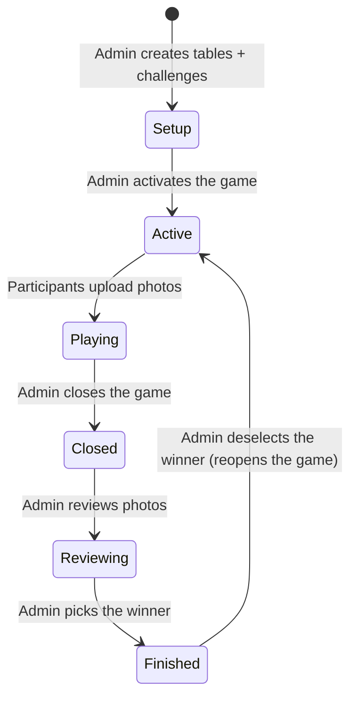

### Backend components

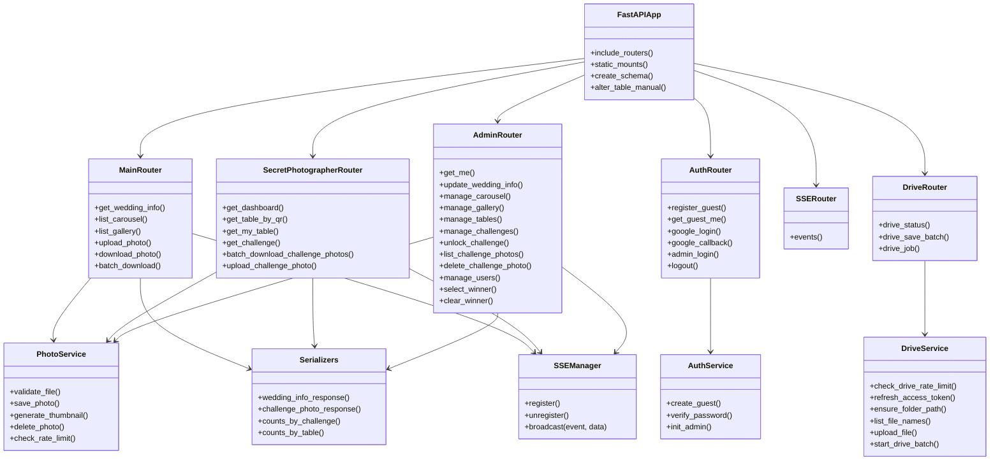

### SSE events emitted by the backend

| Event | Emitted by | Payload |
|---|---|---|
| `new_photo` | `POST /api/gallery/upload` | `{ photo_id }` |
| `gallery_photo_deleted` | `DELETE /api/admin/gallery/{id}` (also when deleting a user with `delete_photos=true`) | `{ photo_id }` |
| `new_challenge_photo` | `POST /api/secret-photographer/upload` | `{ photo_id, challenge_id, table_id }` |
| `challenge_photo_deleted` | `DELETE /api/admin/challenges/{cid}/photos/{pid}` (also when deleting a user with `delete_photos=true`) | `{ photo_id, challenge_id }` |
| `carousel_updated` | Admin carousel ops (upload/delete/reorder) | `{}` |
| `info_updated` | `PUT /api/admin/wedding-info` | Full `WeddingInfoResponse` |
| `winner_selected` | Admin select/deselect winner | `{ table_id }` or `{ table_id: null }` |

> The public dashboard opens its own `EventSource` against `/api/events` (no auth) for `new_challenge_photo`, `challenge_photo_deleted` and `winner_selected`.

### Frontend routes and components

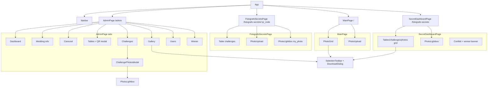

## API

> Interactive docs: **`GET /docs`** (Swagger UI) and `/redoc` (ReDoc), served by FastAPI.

| Method | Route | Auth | Purpose |
|---|---|---|---|
| GET | `/api/wedding-info` | No | Wedding info + winner |
| GET | `/api/carousel` | No | Carousel photos |
| GET | `/api/gallery` | No | Gallery (offset/limit pagination) |
| POST | `/api/gallery/upload` | No (rate limit) | Upload photo + message |
| GET | `/api/gallery/{id}/download` | No | Download one photo |
| POST | `/api/gallery/batch-download` | No | Download several as ZIP (max 100 ids) |
| POST | `/api/guest`, `GET /api/guest/me` | No | Create/query anonymous guest |
| GET | `/api/google`, `/api/google/callback` | No | Google OAuth (`?user_id=X` links, `&drive=1` incremental Drive consent) |
| GET | `/api/drive/status?user_id=X` | No | `{google_linked, drive_ready}` |
| POST | `/api/drive/save-batch` | No (rate limit) | Save up to 100 photos to Drive in the background (`{job_id, total}`) |
| GET | `/api/drive/job/{job_id}?user_id=X` | No | Drive batch status |
| POST | `/api/admin/login`, `/api/logout` | — | Admin session |
| GET | `/api/admin/me` | Admin | Admin session/identity |
| GET | `/api/events` | No | SSE |
| GET | `/api/secret-photographer/dashboard` | No | Public live dashboard |
| GET | `/api/secret-photographer/table/{qr}` | No | Table + challenges + my_photo |
| GET | `/api/secret-photographer/my-table?user_id=X` | No | User's table or `null` |
| POST | `/api/secret-photographer/upload` | No (rate limit) | Upload challenge photo + message |
| POST | `/api/secret-photographer/batch-download` | No | ZIP of challenge photos (`Mesa-XX/…`, max 100 ids) |
| GET | `/api/secret-photographer/challenge/{id}` | No | Challenge detail (blocked) |
| GET | `/api/admin/dashboard` | Admin | Totals (photos, users, tables, challenges, carousel) |
| GET/POST/PUT/DELETE | `/api/admin/tables` | Admin | Table management |
| GET | `/api/admin/tables/{id}/photos` | Admin | Photos per table (winner view) |
| GET/POST/PUT/DELETE | `/api/admin/challenges` | Admin | Challenge management |
| PUT | `/api/admin/challenges/{id}/unlock` | Admin | Unlock challenge for editing/deleting |
| GET | `/api/admin/challenges/{id}/photos` | Admin | Photos of a challenge |
| DELETE | `/api/admin/challenges/{id}/photos/{pid}` | Admin | Delete challenge photo |
| POST/DELETE | `/api/admin/select-winner` | Admin | Pick/remove winner |
| GET/POST/DELETE | `/api/admin/carousel` | Admin | Carousel management |
| PUT | `/api/admin/carousel/reorder` | Admin | Reorder carousel |
| DELETE | `/api/admin/gallery/{id}` | Admin | Delete gallery photo |
| PUT | `/api/admin/wedding-info` | Admin | Edit wedding info/colors |
| GET/POST/DELETE | `/api/admin/users` | Admin | User management (role, alias, table, delete) |
| PATCH | `/api/admin/users/{id}/role` | Admin | Change admin/guest role |
| PUT | `/api/admin/users/{id}` | Admin | Rename alias |
| PATCH | `/api/admin/users/{id}/table` | Admin | Assign/clear table |
| DELETE | `/api/admin/users/{id}?delete_photos=false` | Admin | Delete user; `false` anonymizes photos, `true` deletes them |

## Business rules

- Guests **need no account**: anonymous identity via a server-generated UUID (uuid4) stored in DB and localStorage
- **Google OAuth** (optional) recovers identity across devices; when linked, the alias is replaced by the Google name and profile photo
- Uploads validated by **real MIME type** (byte inspection) + extension; **every image format** (iPhone HEIC/HEIF is converted to JPEG with `exif_transpose`; the original is not kept); max **25 MB**
- Files named with a **UUID** (no collisions); **thumbnails** in a max 150×150 box (aspect ratio preserved)
- **Infinite scroll** pagination (offset/limit)
- **Bulk download by selection** (gallery, admin tab and challenge dashboard): activated by **long-pressing** a photo (~500 ms), deactivated when the selection empties → **single ZIP** (max 100; temp file, deleted after sending) or **individual files** (no limit)
- **Save to Google Drive** (only users with linked Google): incremental `drive.file` consent on first use, per-user refresh token, root folder `Fotos Boda {novio1} y {novio2}` (challenges mirror `Fotografo-Secreto/Mesa-XX`), duplicate skipping, background jobs with polling and toast notifications
- **15 uploads/minute** per user (also for challenges)
- Photos are served by FastAPI (no auth to view)
- Optional **150-character** message on gallery and challenge photos
- Secret Photographer: **1 photo/user/challenge** (unique constraint), max = table participant count; challenges lock when full (admins can unlock to edit/delete)
- A user is assigned to a **table exactly once**; each participant sees **only their own photo** per challenge; viewers see everything on the public dashboard
- **Admins** are `User` rows with `role='admin'` (no separate model); the 3 `.env` emails are re-asserted as admins on every boot; the panel can pre-create users by email and change roles; a Google login with an admin email **merges** any previous guest identity (photos + table)
- Deleting a user can leave photos **anonymous** (`user_id=NULL` → "Anónimo") or **remove** them with their files
- `Miniaturas/` mirrors `Fotos/`; orphan cleanup every 10 s; SQLite in **WAL mode** (no automatic backups)

## Photo directories

```
Fotos/
├── Carrucel/          # Couple's carousel
├── Galeria/           # Guest uploads
└── Fotografo-Secreto/
    ├── Mesa-01/       # QR.png + challenge photos for table 1
    ├── Mesa-02/
    └── ...

Miniaturas/            # Same structure, 150×150 thumbnails
```

## Technical decisions

| Aspect | Decision |
|---|---|
| State management | React Context |
| HTTP client | Native `fetch` + `api()`/`apiUpload()`/`apiBlob()` helpers |
| Pagination | offset/limit |
| Image processing | Pillow (Python) |
| OAuth | Authlib |
| Google Drive | REST v3 via `httpx` (no SDK) |
| QR codes | `qrcode` (Python) |
| DB migrations | `create_all` + hand-written `ALTER TABLE` in the lifespan (no Alembic) |
| Config | pydantic-settings |
| Realtime | SSE (7 named events) |
| Lightbox | Shared `PhotoLightbox` component |
| Versioning | `vX.Y.Z` tags → versioned GHCR images (rollback via `TAG`) |

## Project structure

```
wedding-photo-manager/
├── backend/                  # FastAPI (app/, tests/, Dockerfile)
│   └── app/
│       ├── routers/          # main, auth, fotografo_secreto, admin, drive, sse
│       ├── services/         # photo_service, drive_service, auth_service, sse_manager…
│       ├── models/  schemas/ # SQLAlchemy models + pydantic schemas
│       └── main.py           # app, lifespan (migrations), static mounts
├── frontend/                 # React + Vite (src/, Dockerfile, Dockerfile.dev, nginx.conf.template)
├── docs/screenshots/         # Screenshots used in this README
├── .github/workflows/        # ci.yml (tests) + cd.yml (GHCR images)
├── docker-compose.yml        # Deployment: pulls GHCR images
├── docker-compose.dev.yml    # Development: builds from source
├── tests.md                  # Test-suite guide (Spanish)
├── AGENTS.md                 # Guide for AI coding agents
└── README.es.md              # Spanish version of this README
```

At runtime `Fotos/`, `Miniaturas/` and `data/` are created (git-ignored).

