# Wedding Photo Manager

[](https://github.com/juniornff/wedding-photo-manager/actions/workflows/ci.yml)
[](https://github.com/juniornff/wedding-photo-manager/actions/workflows/cd.yml)
[](LICENSE)
[](#tests-y-cicd)

Aplicación web para gestionar fotos de bodas: los invitados suben, ven y descargan fotos sin registro, y los novios disfrutan del juego interactivo **Fotógrafo Secreto** (retos por mesa con QR) y de un panel de administración completo.

[English](README.md) | **Español**


## Índice

- [Características](#características)
- [Capturas](#capturas)
- [Stack tecnológico](#stack-tecnológico)
- [Puesta en marcha rápida](#puesta-en-marcha-rápida)
- [Úsalo en tu boda](#úsalo-en-tu-boda)
- [Configuración (.env)](#configuración-env)
- [Arquitectura](#arquitectura)
- [API](#api)
- [Reglas de negocio](#reglas-de-negocio)
- [Directorios de fotos](#directorios-de-fotos)
- [Tests y CI/CD](#tests-y-cicd)
- [Decisiones técnicas](#decisiones-técnicas)
- [Estructura del repo](#estructura-del-repo)
- [Contribuir](#contribuir)
- [Licencia](#licencia)

## Características

### Módulo Principal
- Información de la boda (nombres, fecha, mensaje) y **carrusel** de fotos de los novios
- **Galería** de fotos subidas por los invitados, con mensaje opcional (150 caracteres)
- Subida sin login: identidad anónima por dispositivo, con **recuperación vía Google** (nombre y foto de perfil)
- Soporta **todos los formatos de imagen** incluido HEIC/HEIF de iPhone (se convierte a JPEG al subir), hasta 25 MB
- **Descarga múltiple**: mantén presionada una foto para seleccionar varias → ZIP único (máx. 100) o archivos individuales
- **Guardar en Google Drive** (opcional): los usuarios con Google vinculado pueden enviar selecciones a su Drive
- Galería **en vivo** vía SSE (fotos nuevas, borradas, carrusel e info actualizados al instante)

### Módulo Fotógrafo Secreto
- Cada mesa tiene un **QR único** (PNG descargable desde el panel admin); el invitado escanea y se asigna a su mesa automáticamente
- **Retos por mesa** creados desde el admin; 1 foto por participante por reto
- Cada participante ve solo **su propia foto** por reto; nadie más
- **Dashboard público en vivo** (`/fotografo-secreto`): mesas → retos → fotos con autor y progreso, sin login
- El admin elige la **mesa ganadora** y se anuncia en vivo con animación de confetti

### Módulo Admin (`/admin`)
- Info de la boda, colores, carrusel
- Gestión de mesas (con vista de QR) y retos (crear, editar, desbloquear, ver fotos)
- Moderación de la galería y de las fotos de retos
- Gestión de usuarios (rol admin/invitado, mesa, borrar con o sin fotos)
- Selección y deselección de la mesa ganadora

## Capturas

| | |
|---|---|
|  |  |
| Página principal: portada, carrusel y galería | Selección múltiple con barra de descarga |
|  |  |
| Dashboard público del Fotógrafo Secreto | Panel de administración |

## Stack tecnológico

| Capa | Tecnología |
|---|---|
| Backend | FastAPI + SQLAlchemy (async) + SQLite (WAL mode) |
| Backend libs | Pillow (miniaturas) + pillow-heif (HEIC→JPEG), Authlib (OAuth), qrcode (QR), pydantic-settings (config) |
| Frontend | React 19 + Vite + TailwindCSS v4 + React Router |
| Frontend HTTP | fetch nativo + React Context (sin Redux/axios) |
| Tiempo real | Server-Sent Events (SSE) |
| Almacenamiento | Filesystem local (`Fotos/`, `Miniaturas/`) + SQLite (`data/wedding.db`) |
| Autenticación | Google OAuth + UUID anónimo (localStorage) |
| Despliegue | Docker Compose; imágenes en GHCR construidas por GitHub Actions (nginx incluido en la imagen del frontend) |
| Testing | pytest (backend, 174 tests) + Vitest/RTL (frontend, 77 tests) + CI/CD en GitHub Actions |

## Puesta en marcha rápida

**Requisitos:** Docker con Docker Compose.

### Opción A — desde el código fuente (sin cuentas externas)

```bash
git clone https://github.com/juniornff/wedding-photo-manager.git
cd wedding-photo-manager
docker compose -f docker-compose.dev.yml up --build
```

Abre **http://localhost:5173** (backend también expuesto en `localhost:8001`). Ideal para desarrollo: el frontend tiene hot-reload de Vite.

### Opción B — con las imágenes precompiladas (producción)

Las imágenes se publican en GitHub Container Registry en cada push a `master` (`ghcr.io/juniornff/wedding-photo-manager-backend|-frontend`). Al ser privadas, requieren autenticación previa:

```bash
docker login ghcr.io          # usuario + PAT con permiso read:packages
docker compose up -d          # solo pull, sin build
```

Abre **http://localhost:8080** (frontend nginx con SPA + proxy `/api` y SSE).

### Credenciales de ejemplo y `.env`

Ambos compose **funcionan sin `.env`**: traen credenciales de ejemplo en la interpolación (`admin@example.com` / `admin123`, etc.). Para cualquier uso real, crea un `.env` en la raíz del repo — Docker Compose lo lee automáticamente y **sobrescribe** los ejemplos:

```env
ADMIN_EMAIL=tu-email@example.com
ADMIN_PASSWORD=cambia-esta
NOVIO_EMAIL=...
NOVIO_PASSWORD=...
NOVIA_EMAIL=...
NOVIA_PASSWORD=...
SECRET_KEY=un-string-largo-aleatorio
FRONTEND_URL=http://localhost:8080
```

> **Importante**: cambia las credenciales de ejemplo y `SECRET_KEY` antes de exponer la app. Lista completa de variables en [Configuración](#configuración-env).

- Panel de administración: **http://localhost:8080/admin**
- Despliegues futuros: `TAG=<latest|sha-…|X.Y.Z>` en el `.env` elige la versión de imagen (rollback incluido)
- En LAN: abre `http://<IP-de-la-máquina>:8080` desde cualquier dispositivo

## Úsalo en tu boda

1. Levanta el stack y entra a `/admin` con las credenciales de `ADMIN_EMAIL`/`ADMIN_PASSWORD`.
2. **Info Boda**: nombres de los novios, fecha, mensaje y colores de la paleta → portada y páginas legales.
3. **Carrusel**: sube las fotos de la pareja.
4. **Mesas**: crea las mesas del banquete; cada mesa genera un **QR único** (descárgalo e imprímelo por mesa).
5. **Retos**: crea los retos del Fotógrafo Secreto (cantidad libre de retos por mesa).
6. Los invitados entran a la web **sin registro**, escanean el QR de su mesa y juegan.
7. **Ganador**: al terminar, elige la mesa ganadora en el tab Ganador → se anuncia en vivo con confetti en el dashboard público.
8. (Opcional) **Google**: conecta tu cuenta desde la navbar para recuperar identidad entre dispositivos y habilitar el guardado en Google Drive (requiere credenciales OAuth de Google, ver [Configuración](#configuración-env)).

## Configuración (.env)

El archivo `.env` de la raíz (no versionado) es la **única fuente de configuración**; los compose lo interpolan a env vars de cada contenedor (cada servicio solo recibe las variables que necesita). Fuera de Docker, `Settings` (`backend/app/config.py`) también lo lee directamente (archivo faltante se ignora). Las variables de entorno reales tienen prioridad sobre el archivo; `extra="ignore"` tolera claves desconocidas.

| Variable | Uso |
|---|---|
| `ADMIN_EMAIL` / `ADMIN_PASSWORD` | Admin principal (login por contraseña o Google) |
| `NOVIO_EMAIL` / `NOVIO_PASSWORD` | Segundo admin (el novio) |
| `NOVIA_EMAIL` / `NOVIA_PASSWORD` | Tercer admin (la novia) |
| `GOOGLE_CLIENT_ID` / `GOOGLE_CLIENT_SECRET` | OAuth de Google (opcional) |
| `SECRET_KEY` | Clave de las session cookies |
| `FRONTEND_URL` | Origen canónico del frontend (CORS, redirects OAuth, `redirect_uri` de Google) |
| `CORS_ALLOWED_ORIGINS` | Orígenes extra para CORS (CSV), p. ej. la IP LAN del móvil |
| `TAG` | Versión de imagen en el compose de despliegue (default `latest`) |

Opcionales con default en `Settings`: `ORPHAN_CLEANUP_INTERVAL=10`, `MAX_UPLOAD_SIZE=25` (MB), `RATE_LIMIT_PER_MINUTE=15`, `DRIVE_RATE_LIMIT_PER_MINUTE=60`, `DRIVE_UPLOAD_CONCURRENCY=4`, `DATABASE_URL`, `UPLOAD_DIR=Fotos`, `THUMBNAILS_DIR=Miniaturas`.

Notas:

- Los 3 emails del `.env` se reafirman como admins en cada arranque; además el panel admin puede pre-crear usuarios por email y cambiar roles.
- **Google OAuth** (opcional): registra el proyecto en Google Cloud con las URLs legales (`FRONTEND_URL/privacidad` y `/terminos`; la homepage debe enlazarlas). Google solo acepta `localhost` o dominios públicos como `redirect_uri` (jamás IPs privadas); en LAN, `FRONTEND_URL=http://localhost:8080` y los móviles usan la API por CORS (`CORS_ALLOWED_ORIGINS`).
- **Google Drive** (opcional): habilita la Google Drive API y declara el scope `drive.file` (no sensible, sin verificación); la app debe estar **"En producción"** en la consent screen (en "Prueba" los refresh tokens caducan a los 7 días).
- **Frontend**: no usa `.env` propio — la API es relativa y en dev Vite proxya `/api` a `VITE_PROXY_TARGET` (default `http://localhost:8000`; el compose dev usa `http://backend:8000`).
- **API interactiva**: FastAPI sirve Swagger UI en `GET /docs` y ReDoc en `/redoc` (ambos detrás del proxy en producción).

## Arquitectura

### Sistema general

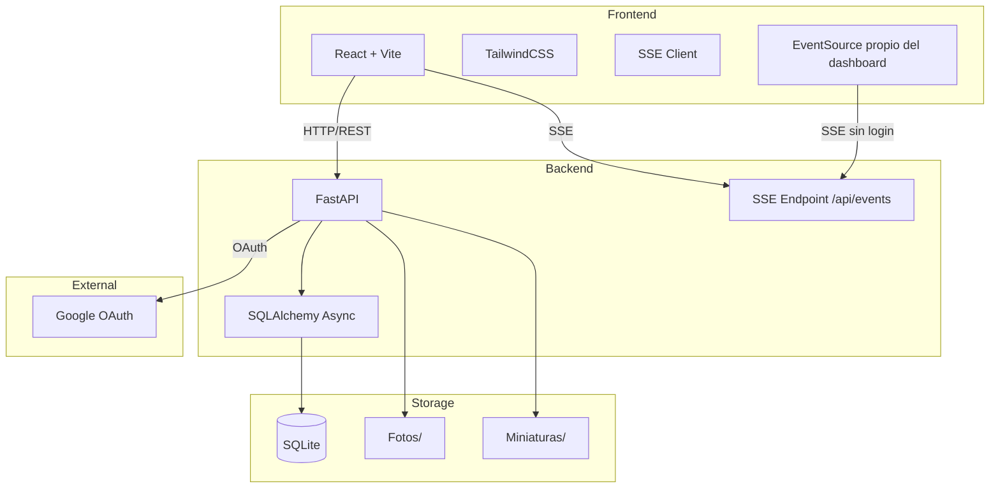

### Módulos

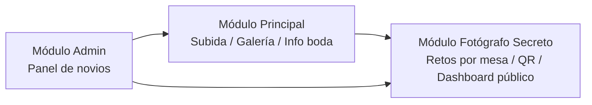

### Entidad-Relación (base de datos)

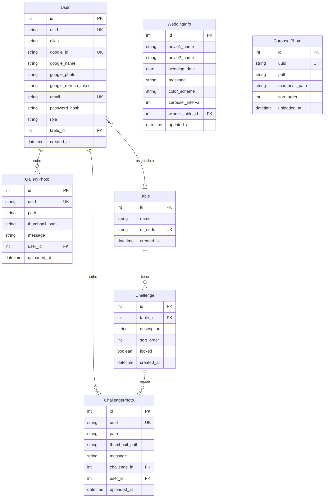

> `Table.name` no es único (solo `qr_code`). Los cambios de esquema se aplican con `Base.metadata.create_all` + `ALTER TABLE` manuales en el lifespan (sin Alembic).

### Casos de uso

```mermaid
graph TB
    INVITADO[Invitado]
    NOVIOS[Novios]
    GOOGLE[Usuario Google OAuth]
    ESPECTADOR[Invitado espectador]

    subgraph "Módulo Principal"
        UC1[Ver info boda]
        UC2[Ver carrusel]
        UC3[Subir foto + mensaje]
        UC4[Ver galería en vivo]
        UC5[Descargar foto]
    end

    subgraph "Fotógrafo Secreto"
        UC6[Escanear QR mesa]
        UC7[Ver retos de mesa]
        UC8[Subir foto + mensaje para reto]
        UC9[Ver mi propia foto por reto]
        UC10[Ver tablero público en vivo]
    end

    subgraph "Admin"
        UC11[Gestionar carrusel]
        UC12[Editar info boda]
        UC13[Cambiar colores]
        UC14[Administrar mesas]
        UC15[Crear/editar/desbloquear retos]
        UC16[Gestionar fotos de retos]
        UC17[Elegir mesa ganadora]
        UC18[Quitar mesa ganadora]
        UC19[Moderar galería]
        UC20[Gestionar usuarios: renombrar, mesa, borrar]
    end

    INVITADO --> UC1
    INVITADO --> UC2
    INVITADO --> UC3
    INVITADO --> UC4
    INVITADO --> UC5
    INVITADO --> UC6
    INVITADO --> UC7
    INVITADO --> UC8
    INVITADO --> UC9

    ESPECTADOR --> UC10

    NOVIOS --> UC11
    NOVIOS --> UC12
    NOVIOS --> UC13
    NOVIOS --> UC14
    NOVIOS --> UC15
    NOVIOS --> UC16
    NOVIOS --> UC17
    NOVIOS --> UC18
    NOVIOS --> UC19
    NOVIOS --> UC20

    GOOGLE -->|Recupera identidad| UC3
    GOOGLE -->|Recupera identidad| UC8
```

### Diagramas de secuencia

#### Acceso de invitado y subida de foto

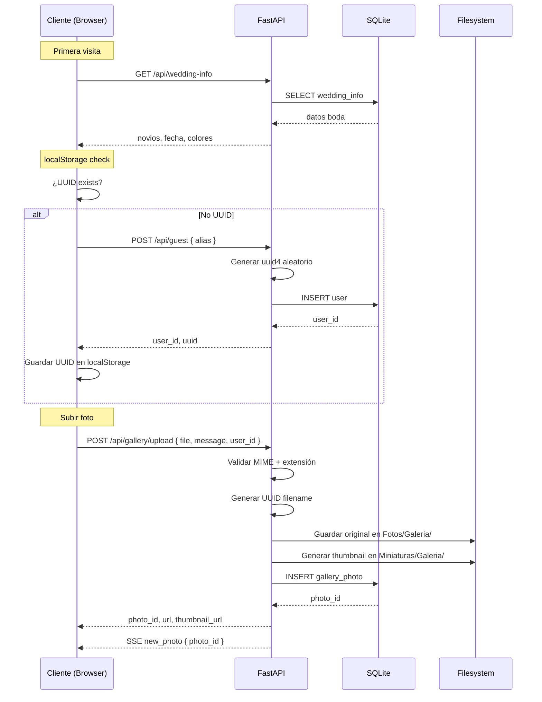

#### Fotógrafo Secreto (participante)

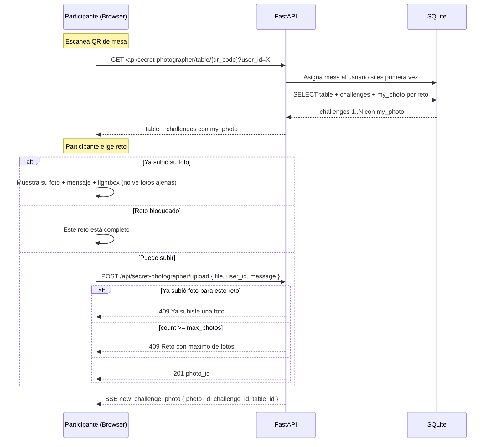

#### Dashboard público (espectador)

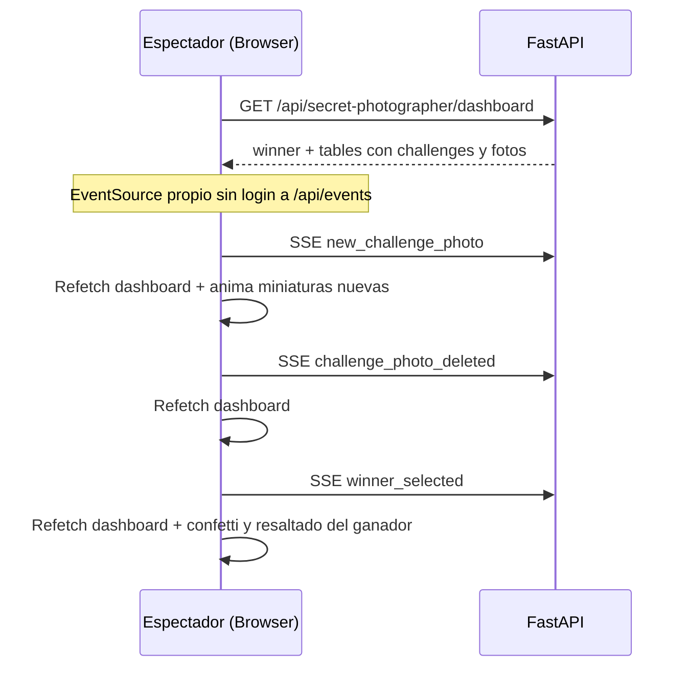

#### Elección de ganador (Admin)

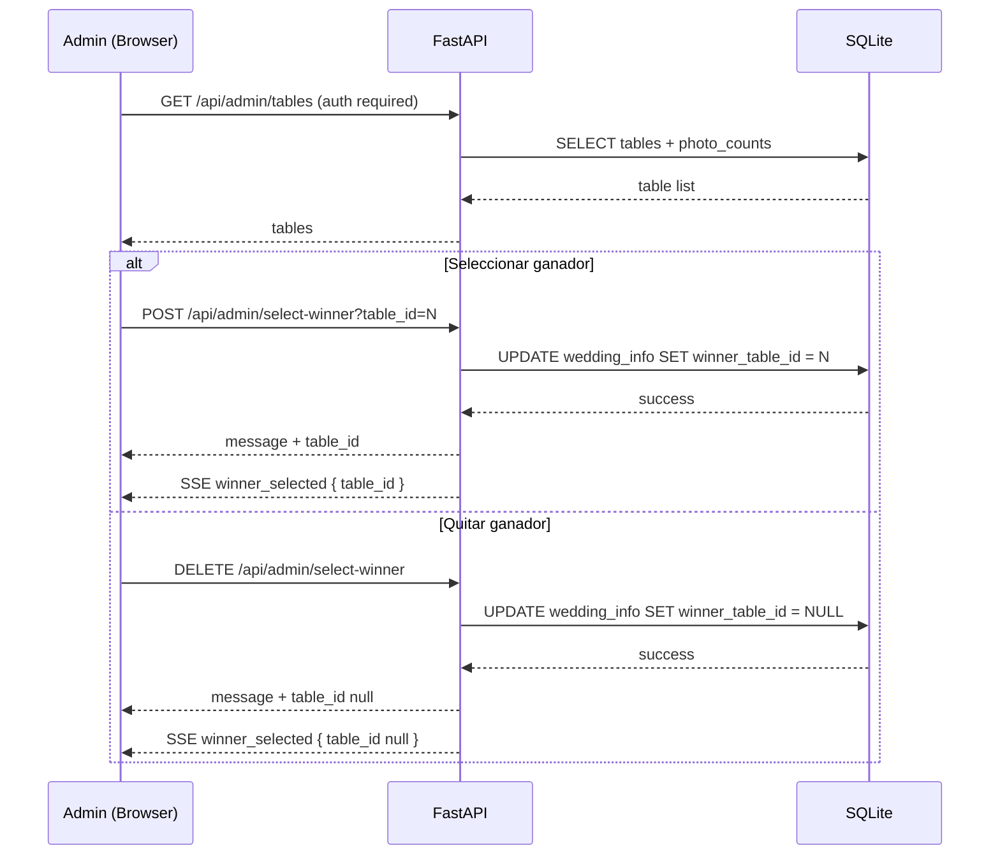

### Estados

#### Ciclo de vida de una foto

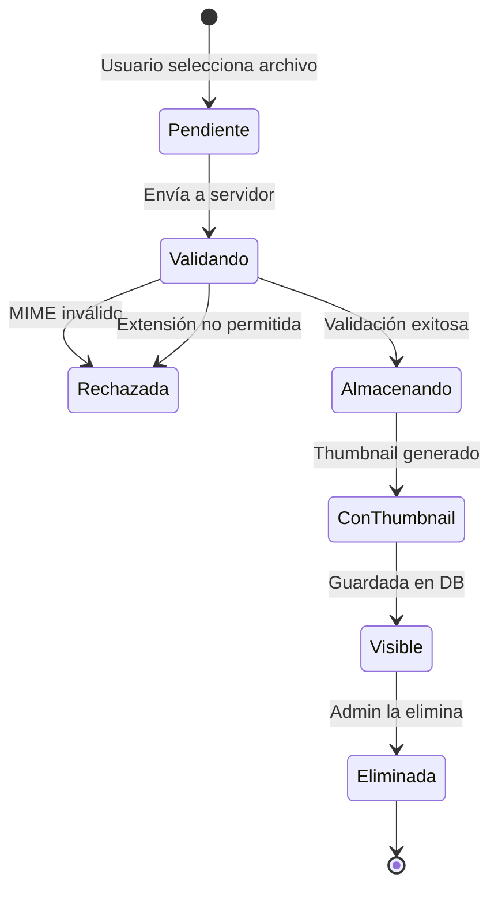

#### Ciclo de vida del juego Fotógrafo Secreto

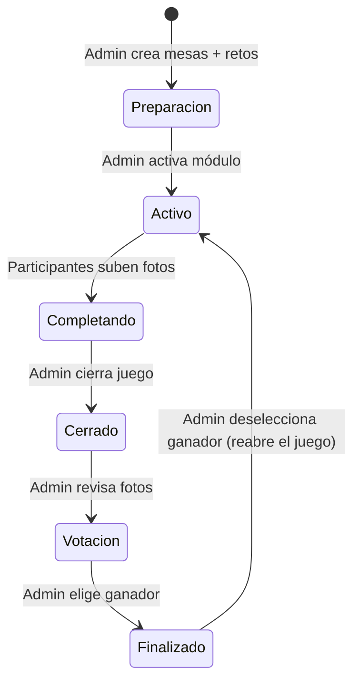

### Componentes del backend

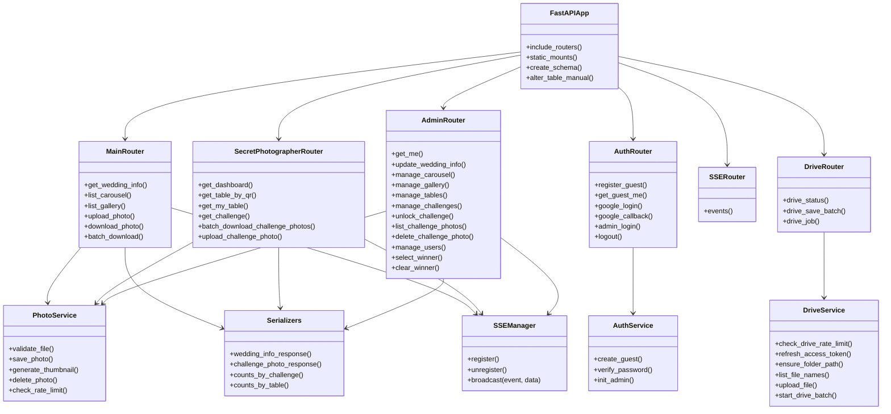

### Eventos SSE emitidos por el backend

| Evento | Emisor | Payload |
|---|---|---|
| `new_photo` | `POST /api/gallery/upload` | `{ photo_id }` |
| `gallery_photo_deleted` | `DELETE /api/admin/gallery/{id}` (y al borrar usuario con `delete_photos=true`) | `{ photo_id }` |
| `new_challenge_photo` | `POST /api/secret-photographer/upload` | `{ photo_id, challenge_id, table_id }` |
| `challenge_photo_deleted` | `DELETE /api/admin/challenges/{cid}/photos/{pid}` (y al borrar usuario con `delete_photos=true`) | `{ photo_id, challenge_id }` |
| `carousel_updated` | Admin carrusel (upload/delete/reorder) | `{}` |
| `info_updated` | `PUT /api/admin/wedding-info` | `WeddingInfoResponse` completo |
| `winner_selected` | Admin seleccionar/quitar ganador | `{ table_id }` o `{ table_id: null }` |

> El dashboard público abre su propio `EventSource` a `/api/events` (sin auth) para `new_challenge_photo`, `challenge_photo_deleted` y `winner_selected`.

### Rutas y componentes del frontend

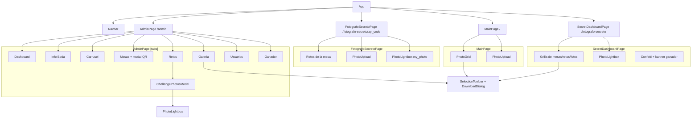

## API

> Swagger UI interactivo: **`GET /docs`** (y ReDoc en `/redoc`), servidos por FastAPI.

| Método | Ruta | Auth | Uso |
|---|---|---|---|
| GET | `/api/wedding-info` | No | Info boda + ganador |
| GET | `/api/carousel` | No | Fotos de carrusel |
| GET | `/api/gallery` | No | Galería (paginación offset/limit) |
| POST | `/api/gallery/upload` | No (rate limit) | Subir foto + mensaje |
| GET | `/api/gallery/{id}/download` | No | Descargar una foto |
| POST | `/api/gallery/batch-download` | No | Descargar varias en ZIP (máx. 100 ids) |
| POST | `/api/guest`, `GET /api/guest/me` | No | Alta/consulta de invitado anónimo |
| GET | `/api/google`, `/api/google/callback` | No | OAuth Google (`?user_id=X` vincula, `&drive=1` consentimiento incremental Drive) |
| GET | `/api/drive/status?user_id=X` | No | `{google_linked, drive_ready}` |
| POST | `/api/drive/save-batch` | No (rate limit) | Guardar hasta 100 fotos en Drive en segundo plano (`{job_id, total}`) |
| GET | `/api/drive/job/{job_id}?user_id=X` | No | Estado del lote Drive |
| POST | `/api/admin/login`, `/api/logout` | — | Sesión admin |
| GET | `/api/admin/me` | Admin | Sesión/identidad del admin |
| GET | `/api/events` | No | SSE |
| GET | `/api/secret-photographer/dashboard` | No | Tablero público en vivo |
| GET | `/api/secret-photographer/table/{qr}` | No | Mesa + retos + my_photo |
| GET | `/api/secret-photographer/my-table?user_id=X` | No | Mesa del usuario o `null` |
| POST | `/api/secret-photographer/upload` | No (rate limit) | Subir foto de reto + mensaje |
| POST | `/api/secret-photographer/batch-download` | No | ZIP de fotos de retos (`Mesa-XX/…`, máx. 100 ids) |
| GET | `/api/secret-photographer/challenge/{id}` | No | Detalle reto (blocked) |
| GET | `/api/admin/dashboard` | Admin | Totales (fotos, usuarios, mesas, retos, carrusel) |
| GET/POST/PUT/DELETE | `/api/admin/tables` | Admin | Gestión mesas |
| GET | `/api/admin/tables/{id}/photos` | Admin | Fotos por mesa (vista ganador) |
| GET/POST/PUT/DELETE | `/api/admin/challenges` | Admin | Gestión retos |
| PUT | `/api/admin/challenges/{id}/unlock` | Admin | Desbloquear reto para editar/eliminar |
| GET | `/api/admin/challenges/{id}/photos` | Admin | Fotos de un reto |
| DELETE | `/api/admin/challenges/{id}/photos/{pid}` | Admin | Borrar foto de reto |
| POST/DELETE | `/api/admin/select-winner` | Admin | Elegir/quitar ganador |
| GET/POST/DELETE | `/api/admin/carousel` | Admin | Gestión carrusel |
| PUT | `/api/admin/carousel/reorder` | Admin | Reordenar carrusel |
| DELETE | `/api/admin/gallery/{id}` | Admin | Borrar foto de galería |
| PUT | `/api/admin/wedding-info` | Admin | Editar info boda/colores |
| GET/POST/DELETE | `/api/admin/users` | Admin | Gestión usuarios (rol, alias, mesa, borrar) |
| PATCH | `/api/admin/users/{id}/role` | Admin | Cambiar rol admin/invitado |
| PUT | `/api/admin/users/{id}` | Admin | Renombrar alias |
| PATCH | `/api/admin/users/{id}/table` | Admin | Asignar/quitar mesa |
| DELETE | `/api/admin/users/{id}?delete_photos=false` | Admin | Borrar usuario; `false` anonimiza fotos, `true` las elimina |

## Reglas de negocio

- Los invitados **no necesitan login**: identidad anónima por UUID en localStorage; el UUID lo genera el **servidor** (uuid4) y se guarda en DB
- **Google OAuth** (opcional) permite recuperar la identidad entre dispositivos; al vincular, el alias se reemplaza por el nombre de Google y se muestra su foto de perfil
- Validación de subida por **MIME type real** (inspección de bytes) + extensión; **todos los formatos** (HEIC/HEIF de iPhone se convierten a JPEG con `exif_transpose`; el original no se conserva); máx. **25 MB**
- Archivos nombrados con **UUID** (sin colisiones); **miniaturas** en caja máxima 150×150 (aspect ratio preservado)
- **Paginación infinita** (offset/limit)
- **Descarga múltiple por selección** (galería, admin y dashboard de retos): se activa **manteniendo presionada** una foto (~500 ms) y se desactiva al quedarse sin selección → **ZIP único** (máx. 100; temporal, se borra tras enviarse) o **archivos individuales** (sin límite)
- **Guardar en Google Drive** (solo usuarios con Google vinculado): consentimiento incremental `drive.file` la primera vez, refresh token por usuario, carpeta `Fotos Boda {novio1} y {novio2}` (los retos replican `Fotografo-Secreto/Mesa-XX`), omite duplicados, jobs en segundo plano con sondeo y avisos por toast
- **15 subidas/minuto** por usuario (también en retos)
- Las fotos se sirven vía FastAPI (sin auth para visualizar)
- Mensaje opcional de **150 caracteres** en galería y en fotos de retos
- Fotógrafo Secreto: **1 foto/usuario/reto** (unique constraint), máx = nº de participantes de la mesa; el reto se bloquea al llenarse (el admin puede desbloquearlo para editar/eliminar)
- Un usuario se asigna a una **mesa una sola vez**; cada participante ve **solo su propia foto** por reto; los espectadores ven todo en el dashboard público
- **Admin**: usuarios con `role='admin'` (sin modelo aparte); los 3 emails del `.env` se reafirman como admin en cada arranque; el panel puede pre-crear usuarios por email y cambiar roles; un login de Google con correo admin **fusiona** la identidad de invitado previa (fotos + mesa)
- Al borrar un usuario, sus fotos pueden quedar **anónimas** (`user_id=NULL` → "Anónimo") o **eliminarse** con sus archivos
- `Miniaturas/` replica la estructura de `Fotos/`; limpieza de huérfanos cada 10 s; SQLite con **WAL mode** (sin backups automáticos)

## Directorios de fotos

```
Fotos/
├── Carrucel/          # Carrusel de los novios
├── Galeria/           # Fotos subidas por invitados
└── Fotografo-Secreto/
    ├── Mesa-01/       # QR.png + fotos de retos de la mesa 1
    ├── Mesa-02/
    └── ...

Miniaturas/            # Misma estructura, miniaturas 150×150
```

## Tests y CI/CD

| Suite | Comando | Alcance |
|---|---|---|
| Backend (174) | `cd backend && python -m pytest -q` | Servicios (validación/miniaturas/HEIC/ZIP/rate-limit), APIs (galería, auth, admin, fotógrafo secreto), Drive y migraciones |
| Frontend (77) | `cd frontend && npm test` | utils/api, hooks (`usePhotoSelection`, `useLongPress`) y componentes |
| Lint/build | `npm run lint` · `npm run build` | oxlint + build de producción |

- La suite de backend es **autocontenida**: no requiere `.env` ni toca datos reales (BD/carpetas temporales). Detalles en [`tests.md`](tests.md).
- **CI** (`.github/workflows/ci.yml`): PRs a `master`/`main` y pushes a `test/**` → pytest (Python 3.13) + lint/test/build (Node 20).
- **CD** (`.github/workflows/cd.yml`): push a `master` o tag `v*` → mismos tests (gating) + build/push de las imágenes a GHCR (`latest`, `sha-…`, versión semver).

## Decisiones técnicas

| Aspecto | Decisión |
|---|---|
| Gestión de estado | React Context |
| Cliente HTTP | `fetch` nativo + helpers `api()`/`apiUpload()`/`apiBlob()` |
| Paginación | offset/limit |
| Imágenes | Pillow (Python) |
| OAuth | Authlib |
| Google Drive | REST v3 con `httpx` (sin SDK) |
| QR | `qrcode` (Python) |
| Migraciones BD | `create_all` + `ALTER TABLE` manuales en el lifespan (sin Alembic) |
| Config | pydantic-settings |
| Tiempo real | SSE (7 eventos nombrados) |
| Lightbox | Componente compartido `PhotoLightbox` |
| Versionado | Tags `vX.Y.Z` → imágenes GHCR versionadas (rollback con `TAG`) |

## Estructura del repo

```
wedding-photo-manager/
├── backend/                  # FastAPI (app/, tests/, Dockerfile)
│   └── app/
│       ├── routers/          # main, auth, fotografo_secreto, admin, drive, sse
│       ├── services/         # photo_service, drive_service, auth_service, sse_manager…
│       ├── models/  schemas/ # modelos SQLAlchemy + schemas pydantic
│       └── main.py           # app, lifespan (migraciones), mounts
├── frontend/                 # React + Vite (src/, Dockerfile, Dockerfile.dev, nginx.conf.template)
├── docs/screenshots/         # Capturas de este README
├── .github/workflows/        # ci.yml (tests) + cd.yml (imágenes GHCR)
├── docker-compose.yml        # Despliegue: pull de imágenes GHCR
├── docker-compose.dev.yml    # Desarrollo: build desde código fuente
├── tests.md                  # Guía de la suite de tests
├── AGENTS.md                 # Guía para agentes de IA
└── README.es.md              # Esta versión en español
```

En ejecución se crean `Fotos/`, `Miniaturas/` y `data/` (ignorados por git).

## Contribuir

¡Las contribuciones son bienvenidas!

1. Abre un **issue** para discutir el cambio (bugs, mejoras, dudas).
2. Haz un **fork** y crea una rama (`feature/...` o `test/...`).
3. Deja todo verde antes del PR:
   ```bash
   (cd backend && python -m pytest -q) && (cd frontend && npm test && npm run lint)
   ```
4. Abre un **PR contra `master`**; el CI debe pasar.
5. Si cambia el comportamiento, mantén `README.md`, `README.es.md` y `tests.md` sincronizados.

Mensajes de commit: cortos y descriptivos.

## Licencia

Distribuido bajo la [Licencia MIT](LICENSE).

## Autor

[@juniornff](https://github.com/juniornff)
