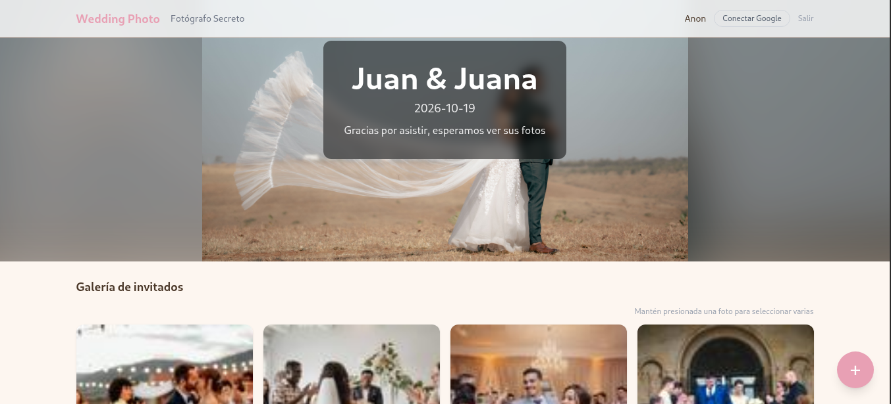
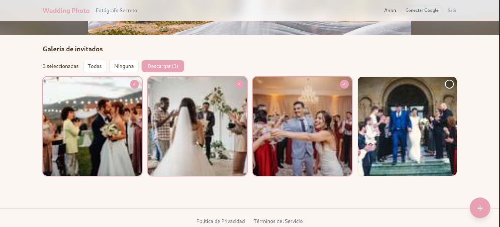
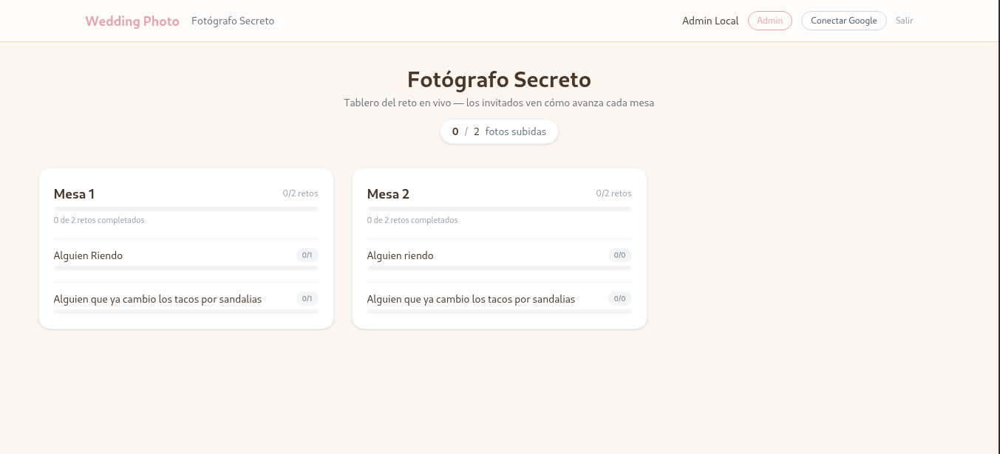
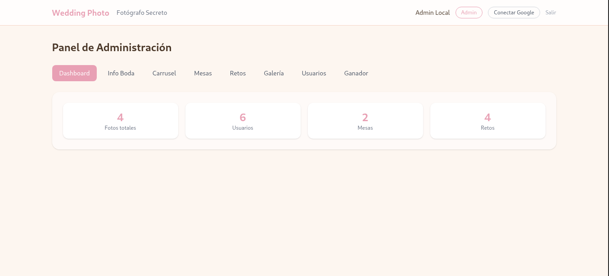

# Wedding Photo Manager

[](https://github.com/juniornff/wedding-photo-manager/actions/workflows/ci.yml)
[](https://github.com/juniornff/wedding-photo-manager/actions/workflows/cd.yml)
[](LICENSE)
[](#tests-y-cicd)

Aplicación web para gestionar fotos de bodas: los invitados suben, ven y descargan fotos sin registro, y los novios disfrutan del juego interactivo **Fotógrafo Secreto** (retos por mesa con QR) y de un panel de administración completo.

[English](README.md) | **Español**

La referencia técnica completa — diagramas de arquitectura, API REST, reglas de negocio y estructura del repo — está en **[ARCHITECTURE.es.md](ARCHITECTURE.es.md)**.



## Índice

- [Características](#características)
- [Capturas](#capturas)
- [Stack tecnológico](#stack-tecnológico)
- [Puesta en marcha rápida](#puesta-en-marcha-rápida)
- [Úsalo en tu boda](#úsalo-en-tu-boda)
- [Configuración (.env)](#configuración-env)
- [Tests y CI/CD](#tests-y-cicd)
- [Documentación](#documentación)
- [Contribuir](#contribuir)
- [Licencia](#licencia)

## Características

### Módulo Principal
- Información de la boda (nombres, fecha, mensaje) y **carrusel** de fotos de los novios
- **Galería** de fotos subidas por los invitados, con mensaje opcional (150 caracteres)
- Subida sin login: identidad anónima por dispositivo, con **recuperación vía Google** (nombre y foto de perfil)
- Soporta **todos los formatos de imagen** incluido HEIC/HEIF de iPhone (se convierte a JPEG al subir), hasta 25 MB
- **Descarga múltiple**: mantén presionada una foto para seleccionar varias → ZIP único (máx. 100) o archivos individuales
- **Guardar en Google Drive** (opcional): los usuarios con Google vinculado pueden enviar selecciones a su Drive
- Galería **en vivo** vía SSE (fotos nuevas, borradas, carrusel e info actualizados al instante)

### Módulo Fotógrafo Secreto
- Cada mesa tiene un **QR único** (PNG descargable desde el panel admin); el invitado escanea y se asigna a su mesa automáticamente
- **Retos por mesa** creados desde el admin; 1 foto por participante por reto
- Cada participante ve solo **su propia foto** por reto; nadie más
- **Dashboard público en vivo** (`/fotografo-secreto`): mesas → retos → fotos con autor y progreso, sin login
- El admin elige la **mesa ganadora** y se anuncia en vivo con animación de confetti

### Módulo Admin (`/admin`)
- Info de la boda, colores, carrusel
- Gestión de mesas (con vista de QR) y retos (crear, editar, desbloquear, ver fotos)
- Moderación de la galería y de las fotos de retos
- Gestión de usuarios (rol admin/invitado, mesa, borrar con o sin fotos)
- Selección y deselección de la mesa ganadora

## Capturas

| | |
|---|---|
|  |  |
| Página principal: portada, carrusel y galería | Selección múltiple con barra de descarga |
|  |  |
| Dashboard público del Fotógrafo Secreto | Panel de administración |

## Stack tecnológico

| Capa | Tecnología |
|---|---|
| Backend | FastAPI + SQLAlchemy (async) + SQLite (WAL mode) |
| Backend libs | Pillow (miniaturas) + pillow-heif (HEIC→JPEG), Authlib (OAuth), qrcode (QR), pydantic-settings (config) |
| Frontend | React 19 + Vite + TailwindCSS v4 + React Router |
| Frontend HTTP | fetch nativo + React Context (sin Redux/axios) |
| Tiempo real | Server-Sent Events (SSE) |
| Almacenamiento | Filesystem local (`Fotos/`, `Miniaturas/`) + SQLite (`data/wedding.db`) |
| Autenticación | Google OAuth + UUID anónimo (localStorage) |
| Despliegue | Docker Compose; imágenes en GHCR construidas por GitHub Actions (nginx incluido en la imagen del frontend) |
| Testing | pytest (backend, 174 tests) + Vitest/RTL (frontend, 77 tests) + CI/CD en GitHub Actions |

## Puesta en marcha rápida

**Requisitos:** Docker con Docker Compose.

### Opción A — desde el código fuente (sin cuentas externas)

```bash
git clone https://github.com/juniornff/wedding-photo-manager.git
cd wedding-photo-manager
docker compose -f docker-compose.dev.yml up --build
```

Abre **http://localhost:5173** (backend también expuesto en `localhost:8001`). Ideal para desarrollo: el frontend tiene hot-reload de Vite.

### Opción B — con las imágenes precompiladas (producción)

Las imágenes se publican en GitHub Container Registry en cada push a `master` (`ghcr.io/juniornff/wedding-photo-manager-backend|-frontend`). Al ser privadas, requieren autenticación previa:

```bash
docker login ghcr.io          # usuario + PAT con permiso read:packages
docker compose up -d          # solo pull, sin build
```

Abre **http://localhost:8080** (frontend nginx con SPA + proxy `/api` y SSE).

### Credenciales de ejemplo y `.env`

Ambos compose **funcionan sin `.env`**: traen credenciales de ejemplo en la interpolación (`admin@example.com` / `admin123`, etc.). Para cualquier uso real, crea un `.env` en la raíz del repo — Docker Compose lo lee automáticamente y **sobrescribe** los ejemplos:

```env
ADMIN_EMAIL=tu-email@example.com
ADMIN_PASSWORD=cambia-esta
NOVIO_EMAIL=...
NOVIO_PASSWORD=...
NOVIA_EMAIL=...
NOVIA_PASSWORD=...
SECRET_KEY=un-string-largo-aleatorio
FRONTEND_URL=http://localhost:8080
```

> **Importante**: cambia las credenciales de ejemplo y `SECRET_KEY` antes de exponer la app. Lista completa de variables en [Configuración](#configuración-env).

- Panel de administración: **http://localhost:8080/admin**
- Despliegues futuros: `TAG=<latest|sha-…|X.Y.Z>` en el `.env` elige la versión de imagen (rollback incluido)
- En LAN: abre `http://<IP-de-la-máquina>:8080` desde cualquier dispositivo

## Úsalo en tu boda

1. Levanta el stack y entra a `/admin` con las credenciales de `ADMIN_EMAIL`/`ADMIN_PASSWORD`.
2. **Info Boda**: nombres de los novios, fecha, mensaje y colores de la paleta → portada y páginas legales.
3. **Carrusel**: sube las fotos de la pareja.
4. **Mesas**: crea las mesas del banquete; cada mesa genera un **QR único** (descárgalo e imprímelo por mesa).
5. **Retos**: crea los retos del Fotógrafo Secreto (cantidad libre de retos por mesa).
6. Los invitados entran a la web **sin registro**, escanean el QR de su mesa y juegan.
7. **Ganador**: al terminar, elige la mesa ganadora en el tab Ganador → se anuncia en vivo con confetti en el dashboard público.
8. (Opcional) **Google**: conecta tu cuenta desde la navbar para recuperar identidad entre dispositivos y habilitar el guardado en Google Drive (requiere credenciales OAuth de Google, ver [Configuración](#configuración-env)).

## Configuración (.env)

El archivo `.env` de la raíz (no versionado) es la **única fuente de configuración**; los compose lo interpolan a env vars de cada contenedor (cada servicio solo recibe las variables que necesita). Fuera de Docker, `Settings` (`backend/app/config.py`) también lo lee directamente (archivo faltante se ignora). Las variables de entorno reales tienen prioridad sobre el archivo; `extra="ignore"` tolera claves desconocidas.

| Variable | Uso |
|---|---|
| `ADMIN_EMAIL` / `ADMIN_PASSWORD` | Admin principal (login por contraseña o Google) |
| `NOVIO_EMAIL` / `NOVIO_PASSWORD` | Segundo admin (el novio) |
| `NOVIA_EMAIL` / `NOVIA_PASSWORD` | Tercer admin (la novia) |
| `GOOGLE_CLIENT_ID` / `GOOGLE_CLIENT_SECRET` | OAuth de Google (opcional) |
| `SECRET_KEY` | Clave de las session cookies |
| `FRONTEND_URL` | Origen canónico del frontend (CORS, redirects OAuth, `redirect_uri` de Google) |
| `CORS_ALLOWED_ORIGINS` | Orígenes extra para CORS (CSV), p. ej. la IP LAN del móvil |
| `TAG` | Versión de imagen en el compose de despliegue (default `latest`) |

Opcionales con default en `Settings`: `ORPHAN_CLEANUP_INTERVAL=10`, `MAX_UPLOAD_SIZE=25` (MB), `RATE_LIMIT_PER_MINUTE=15`, `DRIVE_RATE_LIMIT_PER_MINUTE=60`, `DRIVE_UPLOAD_CONCURRENCY=4`, `DATABASE_URL`, `UPLOAD_DIR=Fotos`, `THUMBNAILS_DIR=Miniaturas`.

Notas:

- Los 3 emails del `.env` se reafirman como admins en cada arranque; además el panel admin puede pre-crear usuarios por email y cambiar roles.
- **Google OAuth** (opcional): registra el proyecto en Google Cloud con las URLs legales (`FRONTEND_URL/privacidad` y `/terminos`; la homepage debe enlazarlas). Google solo acepta `localhost` o dominios públicos como `redirect_uri` (jamás IPs privadas); en LAN, `FRONTEND_URL=http://localhost:8080` y los móviles usan la API por CORS (`CORS_ALLOWED_ORIGINS`).
- **Google Drive** (opcional): habilita la Google Drive API y declara el scope `drive.file` (no sensible, sin verificación); la app debe estar **"En producción"** en la consent screen (en "Prueba" los refresh tokens caducan a los 7 días).
- **Frontend**: no usa `.env` propio — la API es relativa y en dev Vite proxya `/api` a `VITE_PROXY_TARGET` (default `http://localhost:8000`; el compose dev usa `http://backend:8000`).
- **API interactiva**: FastAPI sirve Swagger UI en `GET /docs` y ReDoc en `/redoc` (ambos detrás del proxy en producción).

## Tests y CI/CD

| Suite | Comando | Alcance |
|---|---|---|
| Backend (174) | `cd backend && python -m pytest -q` | Servicios (validación/miniaturas/HEIC/ZIP/rate-limit), APIs (galería, auth, admin, fotógrafo secreto), Drive y migraciones |
| Frontend (77) | `cd frontend && npm test` | utils/api, hooks (`usePhotoSelection`, `useLongPress`) y componentes |
| Lint/build | `npm run lint` · `npm run build` | oxlint + build de producción |

- La suite de backend es **autocontenida**: no requiere `.env` ni toca datos reales (BD/carpetas temporales). Detalles en [`tests.md`](tests.md).
- **CI** (`.github/workflows/ci.yml`): PRs a `master`/`main` y pushes a `test/**` → pytest (Python 3.13) + lint/test/build (Node 20).
- **CD** (`.github/workflows/cd.yml`): push a `master` o tag `v*` → mismos tests (gating) + build/push de las imágenes a GHCR (`latest`, `sha-…`, versión semver).

## Documentación

- **[ARCHITECTURE.es.md](ARCHITECTURE.es.md)** — arquitectura del sistema (12 diagramas Mermaid: visión general, ER, casos de uso, secuencias, estados, componentes), referencia de la API REST, reglas de negocio, decisiones técnicas y estructura del repo · [English](ARCHITECTURE.md)
- **[tests.md](tests.md)** — guía de la suite de tests (backend/frontend): cómo funciona el aislamiento y cómo ejecutarlos
- **[AGENTS.md](AGENTS.md)** — convenciones para agentes de IA que trabajen en este repo

## Contribuir

¡Las contribuciones son bienvenidas!

1. Abre un **issue** para discutir el cambio (bugs, mejoras, dudas).
2. Haz un **fork** y crea una rama (`feature/...` o `test/...`).
3. Deja todo verde antes del PR:
   ```bash
   (cd backend && python -m pytest -q) && (cd frontend && npm test && npm run lint)
   ```
4. Abre un **PR contra `master`**; el CI debe pasar.
5. Si cambia el comportamiento, mantén `README.md`, `README.es.md` y `tests.md` sincronizados.

Mensajes de commit: cortos y descriptivos.

## Licencia

Distribuido bajo la [Licencia MIT](LICENSE).

## Autor

[@juniornff](https://github.com/juniornff)
