# Wedding Photo Manager

Aplicación web para gestionar fotos de bodas: subida, visualización y descarga por parte de los invitados, más el módulo interactivo **Fotógrafo Secreto**.

---

## Stack tecnológico

| Capa | Tecnología |
|---|---|
| Backend | FastAPI + SQLAlchemy (async) + SQLite (WAL mode) |
| Backend libs | Pillow (thumbnails), Authlib (OAuth), qrcode (QR gen) |
| Frontend | React + Vite + TailwindCSS + React Router |
| Frontend HTTP | fetch nativo + React Context (sin Redux/axios) |
| Tiempo real | Server-Sent Events (SSE) |
| Almacenamiento | Local filesystem (`Fotos/`, `Miniaturas/`) |
| Autenticación | Google OAuth + UUID anónimo (localStorage) |
| Despliegue | Docker Compose (backend + frontend); Caddy aparte |
| Testing | pytest (backend) + Vitest (frontend) |

---

## Arquitectura del sistema

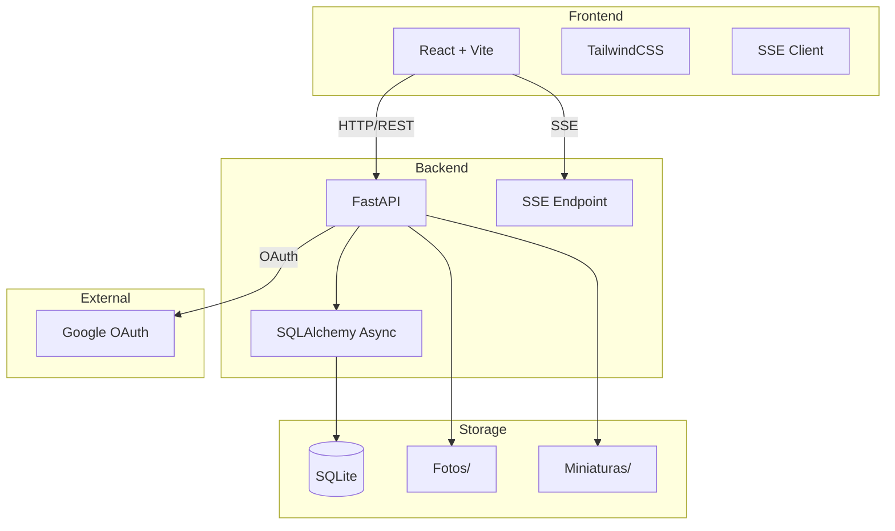

---

## Módulos

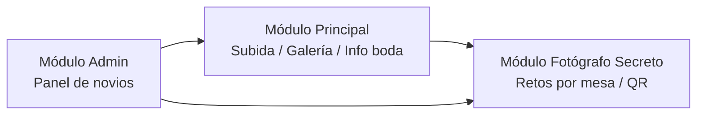

### Módulo Principal
- Información de la boda (nombres, fecha)
- Carrusel de fotos de los novios (`Fotos/Carrucel/`)
- Galería de fotos subidas por invitados (`Fotos/Galeria/`)
- Botón flotante para subir fotos + mensaje (150 caracteres)

### Módulo Fotógrafo Secreto
- Cada mesa tiene un QR único (generado como PNG estático en `Fotos/Fotografo-Secreto/Mesa-XX/QR.png`)
- 10 retos por mesa (creados uno por uno desde el panel admin)
- 1 foto por participante por reto, máximo 3 fotos por reto
- El usuario se asigna a una mesa al escanear el QR (una sola vez, error si reasigna)
- Fotos almacenadas en `Fotos/Fotografo-Secreto/Mesa-XX/`
- Admin elige ganador manualmente; visualización en grilla agrupada por reto

### Módulo Admin
- Gestionar carrusel, info de boda, esquema de colores
- Administrar mesas y retos
- Elegir mesa ganadora del Fotógrafo Secreto

---

## Diagrama Entidad-Relación (Base de Datos)

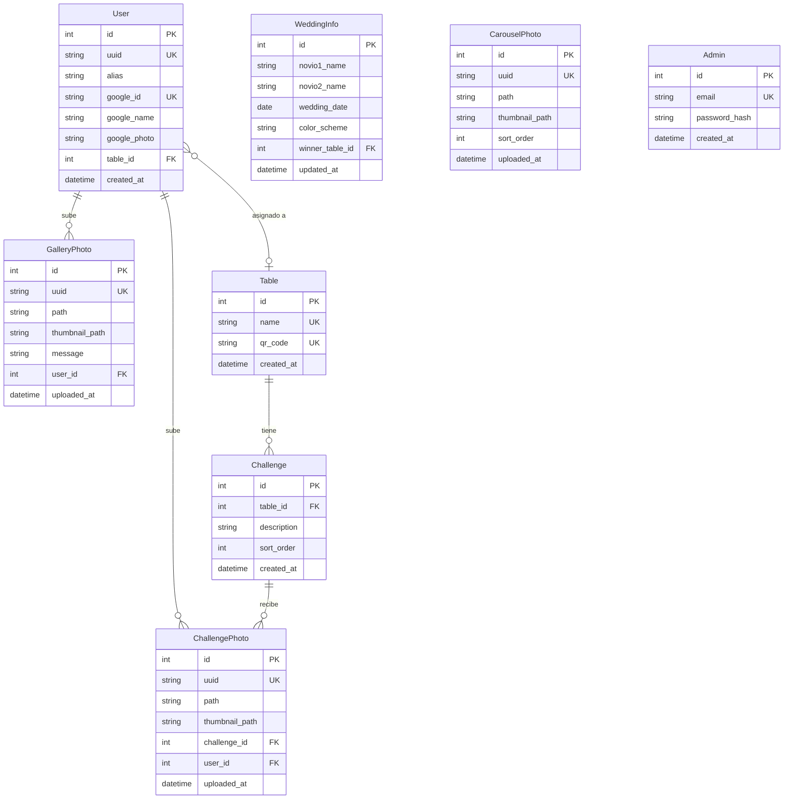

---

## Diagrama de Casos de Uso

```mermaid
graph TB
    INVITADO[Invitado]
    NOVIOS[Novios]
    GOOGLE[Usuario Google OAuth]

    subgraph "Módulo Principal"
        UC1[Ver info boda]
        UC2[Ver carrusel]
        UC3[Subir foto + mensaje]
        UC4[Ver galería]
        UC5[Descargar foto]
    end

    subgraph "Fotógrafo Secreto"
        UC6[Escanear QR mesa]
        UC7[Ver retos de mesa]
        UC8[Subir foto para reto]
    end

    subgraph "Admin"
        UC9[Gestionar carrusel]
        UC10[Editar info boda]
        UC11[Cambiar colores]
        UC12[Administrar mesas]
        UC13[Crear/editar retos]
        UC14[Elegir mesa ganadora]
        UC15[Moderar galería]
    end

    INVITADO --> UC1
    INVITADO --> UC2
    INVITADO --> UC3
    INVITADO --> UC4
    INVITADO --> UC5
    INVITADO --> UC6
    INVITADO --> UC7
    INVITADO --> UC8

    NOVIOS --> UC9
    NOVIOS --> UC10
    NOVIOS --> UC11
    NOVIOS --> UC12
    NOVIOS --> UC13
    NOVIOS --> UC14
    NOVIOS --> UC15

    GOOGLE -->|Recupera identidad| UC3
    GOOGLE -->|Recupera identidad| UC8
```

---

## Diagramas de Secuencia

### Flujo: Acceso de invitado y subida de foto

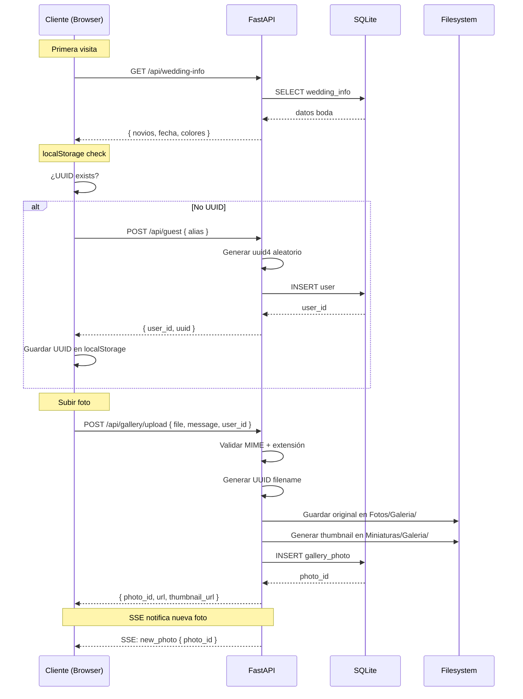

### Flujo: Fotógrafo Secreto

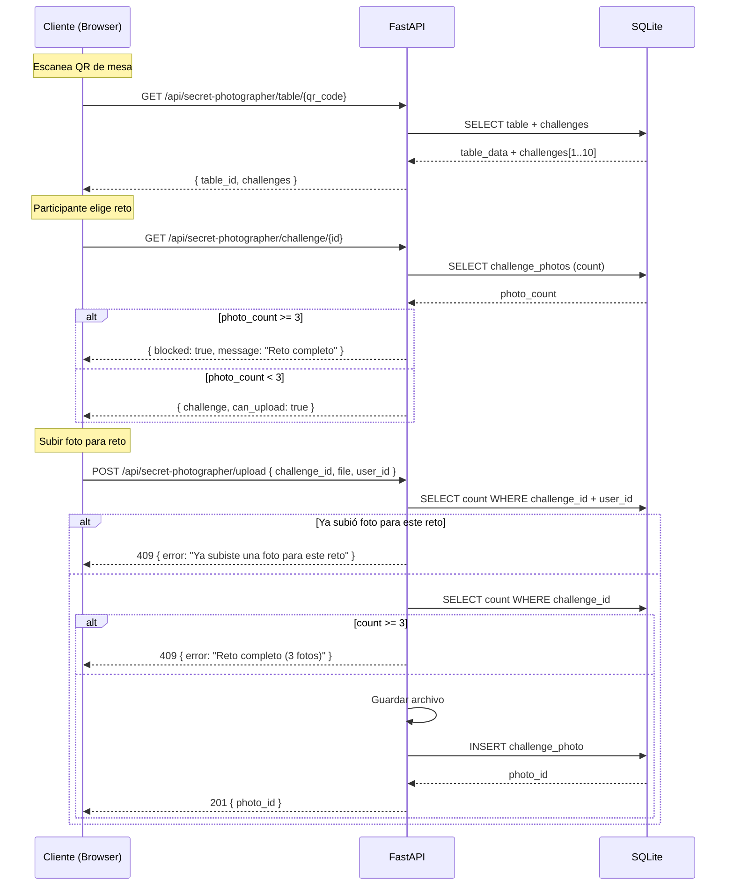

### Flujo: Elección de ganador (Admin)

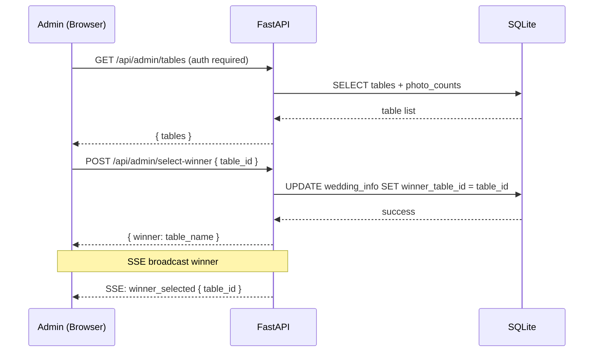

---

## Diagrama de Estados

### Ciclo de vida de una foto

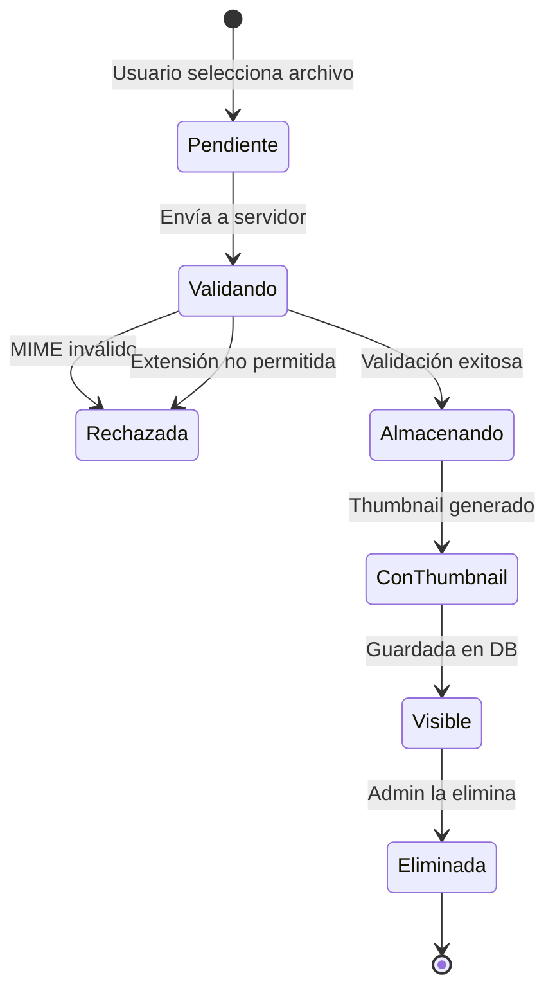

### Ciclo de vida del juego Fotógrafo Secreto

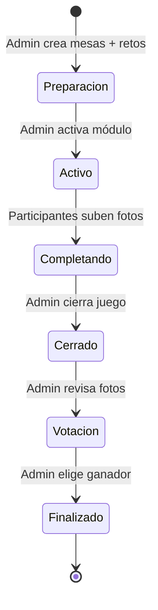

---

## Diagrama de Componentes del Backend

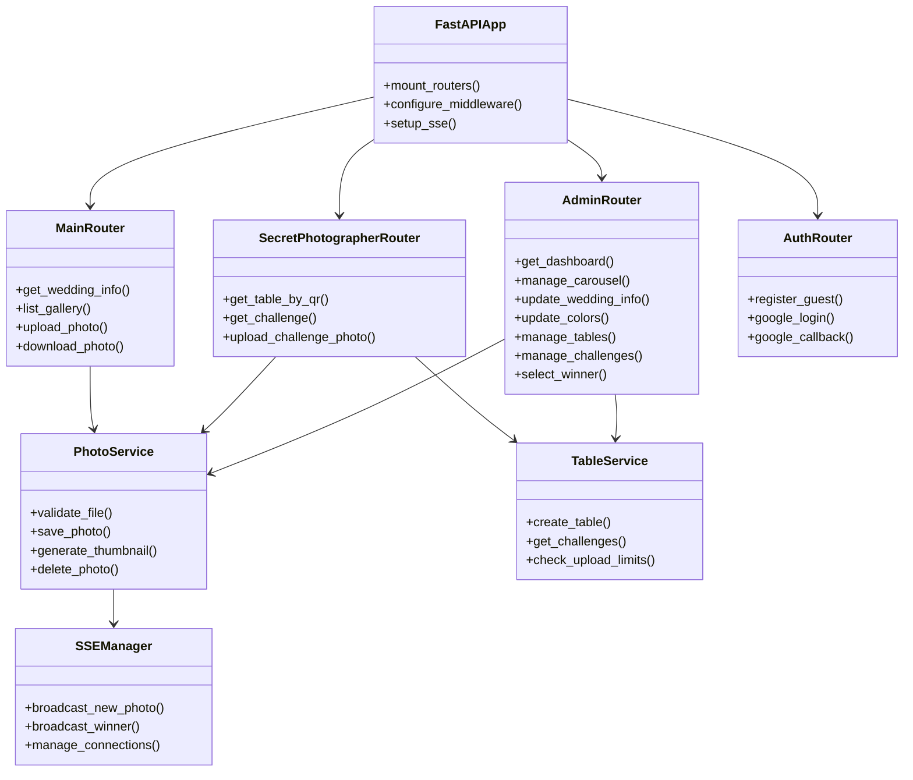

---

## Árbol de componentes del Frontend

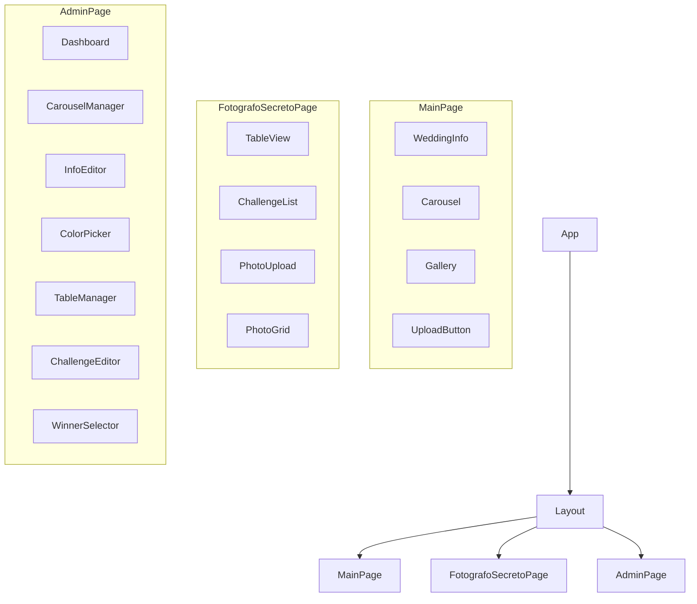

---

## Directorios de fotos

```
Fotos/
├── Carrucel/          # Carrusel de los novios
├── Galeria/           # Fotos subidas por invitados
└── Fotografo-Secreto/
    ├── Mesa-01/       # Fotos de mesa 1
    ├── Mesa-02/       # Fotos de mesa 2
    └── ...

Miniaturas/
├── Carrucel/
├── Galeria/
└── Fotografo-Secreto/
    └── Mesa-XX/
```

---

## Reglas de negocio clave

- Los invitados **no necesitan login** — se identifican por UUID en localStorage
- El **UUID lo genera el servidor** (`uuid4` aleatorio), se guarda en DB y se devuelve al cliente
- Google OAuth permite **recuperar identidad** entre dispositivos; al vincularse, el alias se reemplaza por el nombre de Google y se muestra su foto de perfil
- Solo imágenes (validación por **MIME type real** inspeccionando bytes + extensión)
- **Todos los formatos** de imagen son aceptados
- Tamaño máximo: **25 MB**
- Nombres de archivo con **UUID** para evitar colisiones
- **Miniatura 150×150px** generada automáticamente en la subida (manteniendo aspect ratio)
- **Paginación infinita** con offset/limit
- **15 subidas/minuto** por usuario (rate limit)
- Las fotos se sirven **a través de FastAPI** (sin autenticación para visualizar)
- Fotógrafo Secreto: **1 foto/usuario/reto**, máximo **3 fotos/reto**
- Un usuario se asigna a una **mesa una sola vez** (campo `table_id` en User)
- Los retos bloqueados al llegar a 3 fotos; admin puede desbloquear solo para editar/eliminar
- **Admin**: Google OAuth + session cookies + verificación contra emails en `.env`
- **Admin inicial** creado desde `.env` (email + password)
- `Miniaturas/` replica exactamente la estructura de `Fotos/`
- **Limpieza de archivos huérfanos** cada 10s (configurable vía `.env`)
- **SQLite con WAL mode** para concurrencia
- Sin backups automáticos (evento pequeño: ~50 invitados)
- Configuración sensible en **`.env`** (no versionado)

## Variables de entorno (`.env`)

| Variable | Descripción |
|---|---|
| `ADMIN_EMAIL` | Email del admin para OAuth |
| `ADMIN_PASSWORD` | Password del admin inicial |
| `GOOGLE_CLIENT_ID` | Google OAuth client ID |
| `GOOGLE_CLIENT_SECRET` | Google OAuth client secret |
| `SECRET_KEY` | Clave para session cookies |
| `ORPHAN_CLEANUP_INTERVAL` | Intervalo de limpieza de huérfanos (default: 10) |

## Decisiones técnicas adoptadas

| Aspecto | Decisión |
|---|---|
| Gestión de estado | React Context |
| Cliente HTTP | `fetch` nativo + hook personalizado |
| Paginación | offset/limit |
| Procesamiento de imágenes | Pillow (Python) |
| OAuth | Authlib |
| Generación de QR | `qrcode` (Python) |
| Migraciones BD | `SQLAlchemy.create_all()` al iniciar |
| Entorno dev | `docker compose up` |
| Python | Última versión estable |
| Node | Última versión estable |
