# Wedding Photo Manager

[](https://github.com/juniornff/wedding-photo-manager/actions/workflows/ci.yml)
[](https://github.com/juniornff/wedding-photo-manager/actions/workflows/cd.yml)
[](LICENSE)
[](#tests--ciud)

Web application to manage wedding photos: guests upload, browse and download photos **without signing up**, while the couple enjoys the interactive **Secret Photographer** game (per-table challenges with QR codes) and a full admin panel.

**English** | [Español](README.es.md)


## Contents

- [Features](#features)
- [Screenshots](#screenshots)
- [Tech stack](#tech-stack)
- [Quick start](#quick-start)
- [Use it for your wedding](#use-it-for-your-wedding)
- [Configuration (.env)](#configuration-env)
- [Architecture](#architecture)
- [API](#api)
- [Business rules](#business-rules)
- [Photo directories](#photo-directories)
- [Tests & CI/CD](#tests--ciud)
- [Technical decisions](#technical-decisions)
- [Project structure](#project-structure)
- [Contributing](#contributing)
- [License](#license)

## Features

### Main module
- Wedding info (names, date, message) and a **carousel** of the couple's photos
- **Gallery** of photos uploaded by guests, with an optional message (150 characters)
- Uploads with **no account**: anonymous per-device identity, recoverable via **Google sign-in** (name and profile photo)
- **Every image format** supported, including iPhone HEIC/HEIF (converted to JPEG on upload), up to 25 MB
- **Bulk download**: long-press a photo to select several → single ZIP (max 100) or individual files
- **Save to Google Drive** (optional): users with a linked Google account can send selections to their Drive
- **Live** gallery via SSE (new/removed photos and updates appear instantly)

### Secret Photographer module
- Every table has a **unique QR code** (PNG downloadable from the admin panel); guests scan it and are assigned to their table automatically
- **Per-table challenges** created by the admins; one photo per participant per challenge
- Each participant only sees **their own photo** per challenge — nobody else's
- **Public live dashboard** (`/fotografo-secreto`): tables → challenges → photos with author and progress, no login required
- The admin picks the **winning table**, announced live with a confetti animation

### Admin module (`/admin`)
- Wedding info, color palette, carousel
- Table management (with QR view) and challenge management (create, edit, unlock, browse photos)
- Gallery and challenge-photo moderation
- User management (admin/guest role, table assignment, delete with or without photos)
- Select/deselect the winning table

## Screenshots

| | |
|---|---|
|  |  |
| Main page: hero, carousel and guest gallery | Multi-selection with the download toolbar |
|  |  |
| Public Secret Photographer dashboard | Admin panel |

## Tech stack

| Layer | Technology |
|---|---|
| Backend | FastAPI + SQLAlchemy (async) + SQLite (WAL mode) |
| Backend libs | Pillow (thumbnails) + pillow-heif (HEIC→JPEG), Authlib (OAuth), qrcode (QR), pydantic-settings (config) |
| Frontend | React 19 + Vite + TailwindCSS v4 + React Router |
| Frontend HTTP | Native fetch + React Context (no Redux/axios) |
| Realtime | Server-Sent Events (SSE) |
| Storage | Local filesystem (`Fotos/`, `Miniaturas/`) + SQLite (`data/wedding.db`) |
| Auth | Google OAuth + anonymous UUID (localStorage) |
| Deployment | Docker Compose; images on GHCR built by GitHub Actions (nginx included in the frontend image) |
| Testing | pytest (backend, 174 tests) + Vitest/RTL (frontend, 77 tests) + CI/CD on GitHub Actions |

## Quick start

**Requirements:** Docker with Docker Compose.

### Option A — from source (no external accounts)

```bash
git clone https://github.com/juniornff/wedding-photo-manager.git
cd wedding-photo-manager
docker compose -f docker-compose.dev.yml up --build
```

Open **http://localhost:5173** (backend also exposed on `localhost:8001`). Best for development: Vite hot-reload included.

### Option B — pre-built images (production)

Images are published to GitHub Container Registry on every push to `master` (`ghcr.io/juniornff/wedding-photo-manager-backend|-frontend`). Being private, they require authentication first:

```bash
docker login ghcr.io          # username + PAT with read:packages
docker compose up -d          # pull only, no build
```

Open **http://localhost:8080** (nginx frontend serving the SPA with `/api` and SSE proxying).

### Example credentials and `.env`

Both compose files **work without a `.env`**: they ship example credentials in the interpolation (`admin@example.com` / `admin123`, etc.). For any real use, create a `.env` in the repo root — Docker Compose reads it automatically and **overrides** the examples:

```env
ADMIN_EMAIL=your-email@example.com
ADMIN_PASSWORD=change-this
NOVIO_EMAIL=...
NOVIO_PASSWORD=...
NOVIA_EMAIL=...
NOVIA_PASSWORD=...
SECRET_KEY=a-long-random-string
FRONTEND_URL=http://localhost:8080
```

> **Important**: change the example credentials and `SECRET_KEY` before exposing the app. Full variable list under [Configuration](#configuration-env).

- Admin panel: **http://localhost:8080/admin**
- Future deployments: `TAG=<latest|sha-…|X.Y.Z>` in the `.env` picks the image version (rollback included)
- On your LAN: open `http://<machine-IP>:8080` from any device

## Use it for your wedding

1. Start the stack and sign in to `/admin` with `ADMIN_EMAIL`/`ADMIN_PASSWORD`.
2. **Wedding info**: couple names, date, message and color palette → front page and legal pages.
3. **Carousel**: upload the couple's photos.
4. **Tables**: create the reception tables; each one generates a **unique QR code** (download and print one per table).
5. **Challenges**: create the Secret Photographer challenges (any number of challenges per table).
6. Guests visit the site **with no account**, scan their table's QR and play.
7. **Winner**: when the game ends, pick the winning table in the Winner tab → announced live with confetti on the public dashboard.
8. (Optional) **Google**: connect an account from the navbar to recover identity across devices and enable Google Drive saving (requires Google OAuth credentials, see [Configuration](#configuration-env)).

## Configuration (.env)

The root `.env` file (not versioned) is the **single source of configuration**; the compose files interpolate it into each container's environment (each service only receives the variables it needs). Outside Docker, `Settings` (`backend/app/config.py`) also reads it directly (missing file is ignored). Real environment variables take precedence over the file; `extra="ignore"` tolerates unknown keys.

| Variable | Purpose |
|---|---|
| `ADMIN_EMAIL` / `ADMIN_PASSWORD` | Main admin (password or Google login) |
| `NOVIO_EMAIL` / `NOVIO_PASSWORD` | Second admin (the groom) |
| `NOVIA_EMAIL` / `NOVIA_PASSWORD` | Third admin (the bride) |
| `GOOGLE_CLIENT_ID` / `GOOGLE_CLIENT_SECRET` | Google OAuth (optional) |
| `SECRET_KEY` | Session-cookie signing key |
| `FRONTEND_URL` | Canonical frontend origin (CORS, OAuth redirects, Google `redirect_uri`) |
| `CORS_ALLOWED_ORIGINS` | Extra CORS origins (CSV), e.g. a phone's LAN IP |
| `TAG` | Image version in the deploy compose (default `latest`) |

Optional, with defaults in `Settings`: `ORPHAN_CLEANUP_INTERVAL=10`, `MAX_UPLOAD_SIZE=25` (MB), `RATE_LIMIT_PER_MINUTE=15`, `DRIVE_RATE_LIMIT_PER_MINUTE=60`, `DRIVE_UPLOAD_CONCURRENCY=4`, `DATABASE_URL`, `UPLOAD_DIR=Fotos`, `THUMBNAILS_DIR=Miniaturas`.

Notes:

- The 3 `.env` emails are re-asserted as admins on every boot; the admin panel can also pre-create users by email and change roles.
- **Google OAuth** (optional): register the project in Google Cloud with the legal URLs (`FRONTEND_URL/privacidad` and `/terminos`; the homepage must link to them). Google only accepts `localhost` or public domains as `redirect_uri` (never private IPs); on a LAN use `FRONTEND_URL=http://localhost:8080` and let phones hit the API via CORS (`CORS_ALLOWED_ORIGINS`).
- **Google Drive** (optional): enable the Google Drive API and declare the `drive.file` scope (non-sensitive, no verification); the app must be **"In production"** on the consent screen (in "Testing", refresh tokens expire after 7 days).
- **Frontend**: no `.env` of its own — the API is relative and in dev Vite proxies `/api` to `VITE_PROXY_TARGET` (default `http://localhost:8000`; the dev compose uses `http://backend:8000`).
- **Interactive API docs**: FastAPI serves Swagger UI at `GET /docs` and ReDoc at `/redoc` (both reachable through the proxy in production).

## Architecture

### System overview

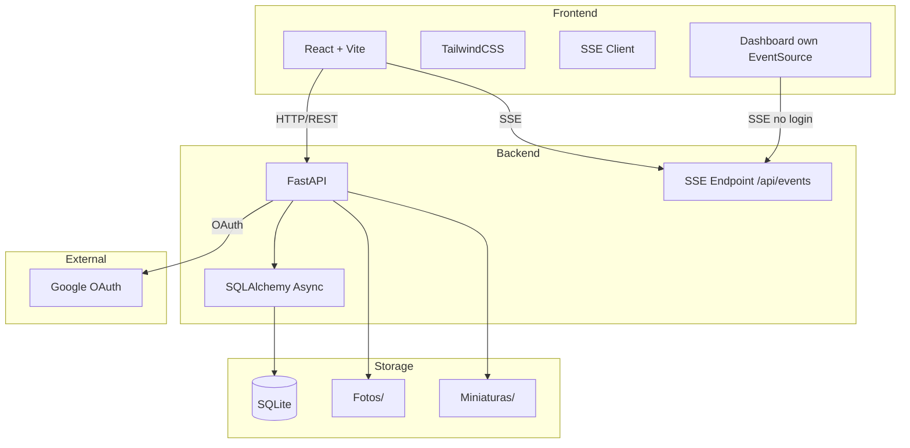

### Modules

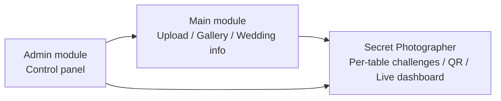

### Entity-Relationship (database)

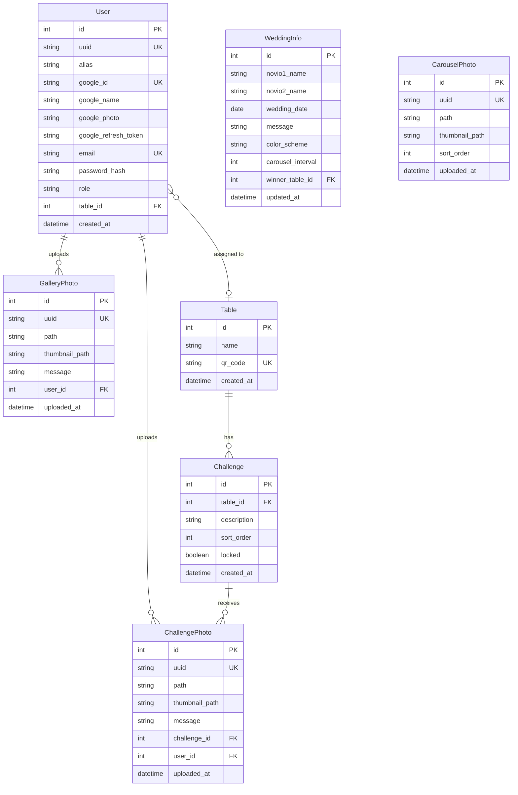

> `Table.name` is not unique (only `qr_code` is). Schema changes are applied with `Base.metadata.create_all` plus hand-written `ALTER TABLE` statements in the lifespan (no Alembic).

### Use cases

```mermaid
graph TB
    GUEST[Guest]
    COUPLE[Couple]
    GOOGLE[Google OAuth user]
    VIEWER[Guest viewer]

    subgraph "Main module"
        UC1[View wedding info]
        UC2[View carousel]
        UC3[Upload photo + message]
        UC4[View live gallery]
        UC5[Download photo]
    end

    subgraph "Secret Photographer"
        UC6[Scan table QR]
        UC7[View table challenges]
        UC8[Upload photo + message for a challenge]
        UC9[View my own photo per challenge]
        UC10[View public live dashboard]
    end

    subgraph "Admin"
        UC11[Manage carousel]
        UC12[Edit wedding info]
        UC13[Change colors]
        UC14[Manage tables]
        UC15[Create/edit/unlock challenges]
        UC16[Manage challenge photos]
        UC17[Pick winning table]
        UC18[Remove winning table]
        UC19[Moderate gallery]
        UC20[Manage users: rename, table, delete]
    end

    GUEST --> UC1
    GUEST --> UC2
    GUEST --> UC3
    GUEST --> UC4
    GUEST --> UC5
    GUEST --> UC6
    GUEST --> UC7
    GUEST --> UC8
    GUEST --> UC9

    VIEWER --> UC10

    COUPLE --> UC11
    COUPLE --> UC12
    COUPLE --> UC13
    COUPLE --> UC14
    COUPLE --> UC15
    COUPLE --> UC16
    COUPLE --> UC17
    COUPLE --> UC18
    COUPLE --> UC19
    COUPLE --> UC20

    GOOGLE -->|Recovers identity| UC3
    GOOGLE -->|Recovers identity| UC8
```

### Sequence diagrams

#### Guest access and photo upload

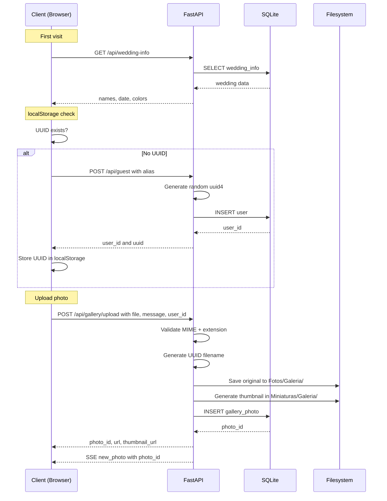

#### Secret Photographer (participant)

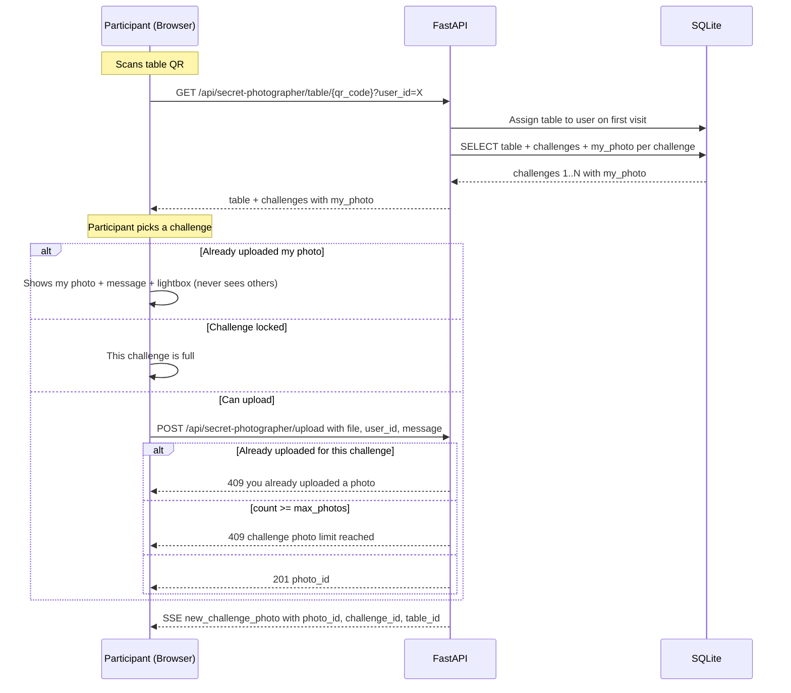

#### Public dashboard (viewer)

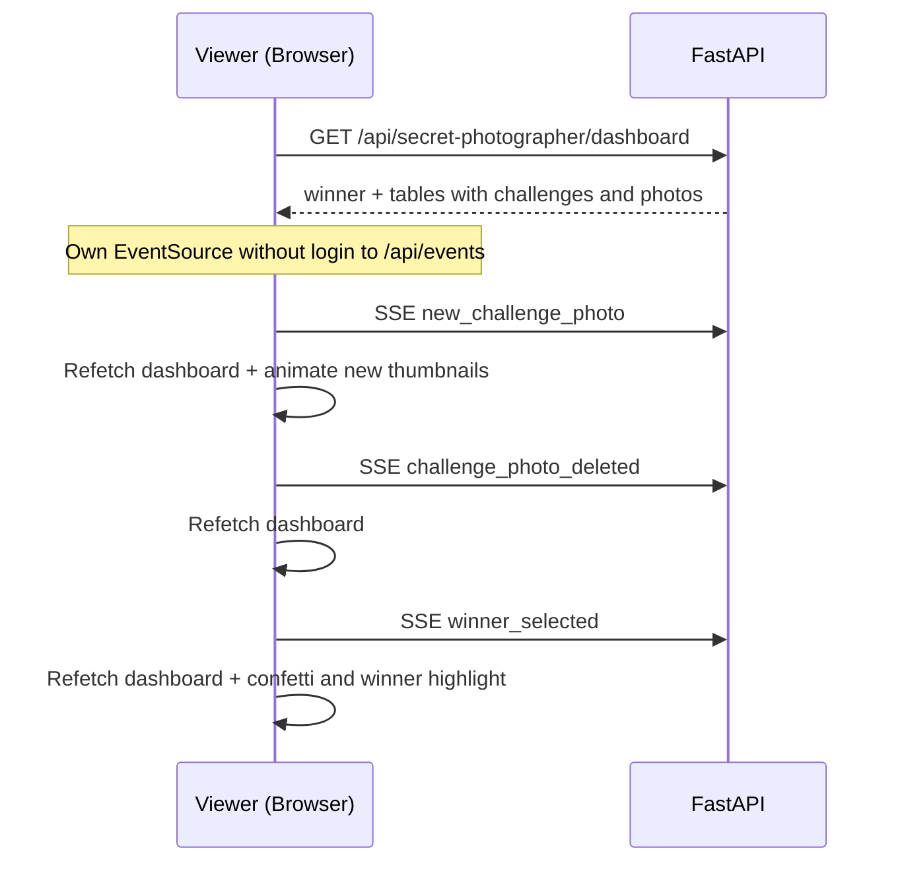

#### Winner selection (Admin)

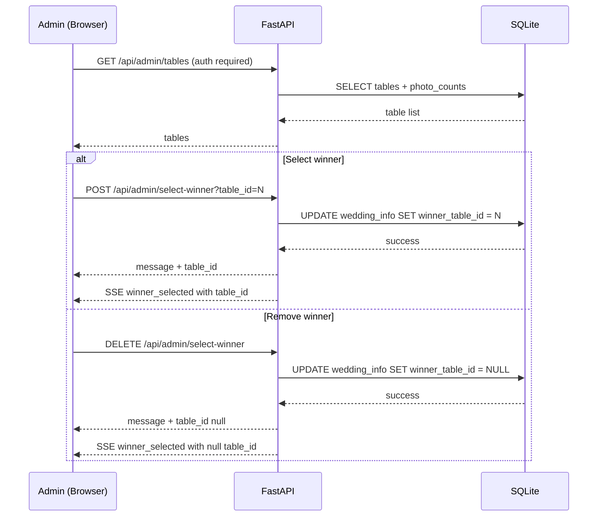

### State diagrams

#### Photo lifecycle

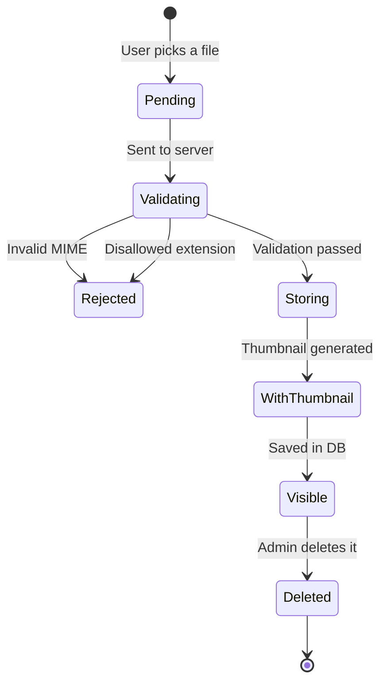

#### Secret Photographer game lifecycle

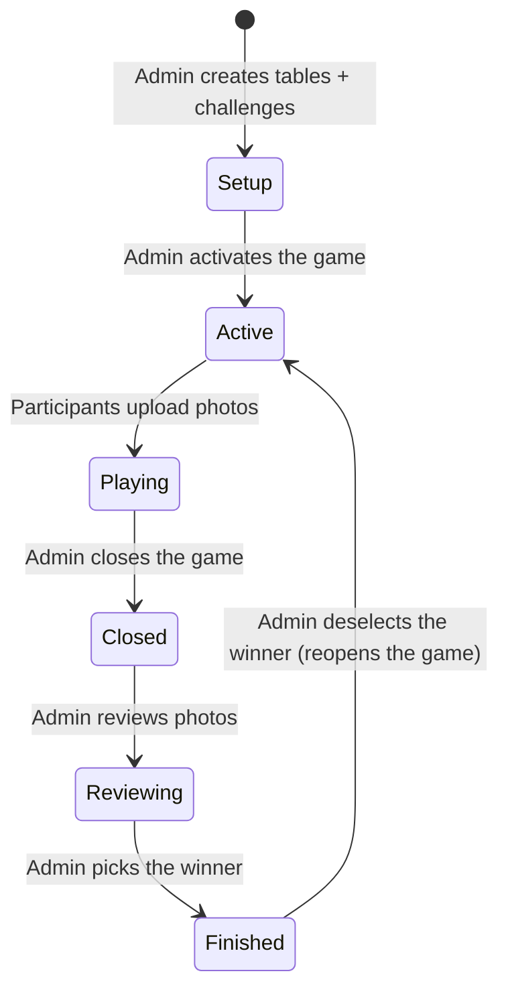

### Backend components

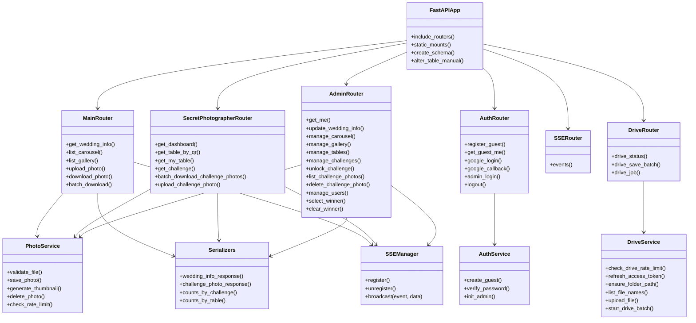

### SSE events emitted by the backend

| Event | Emitted by | Payload |
|---|---|---|
| `new_photo` | `POST /api/gallery/upload` | `{ photo_id }` |
| `gallery_photo_deleted` | `DELETE /api/admin/gallery/{id}` (also when deleting a user with `delete_photos=true`) | `{ photo_id }` |
| `new_challenge_photo` | `POST /api/secret-photographer/upload` | `{ photo_id, challenge_id, table_id }` |
| `challenge_photo_deleted` | `DELETE /api/admin/challenges/{cid}/photos/{pid}` (also when deleting a user with `delete_photos=true`) | `{ photo_id, challenge_id }` |
| `carousel_updated` | Admin carousel ops (upload/delete/reorder) | `{}` |
| `info_updated` | `PUT /api/admin/wedding-info` | Full `WeddingInfoResponse` |
| `winner_selected` | Admin select/deselect winner | `{ table_id }` or `{ table_id: null }` |

> The public dashboard opens its own `EventSource` against `/api/events` (no auth) for `new_challenge_photo`, `challenge_photo_deleted` and `winner_selected`.

### Frontend routes and components

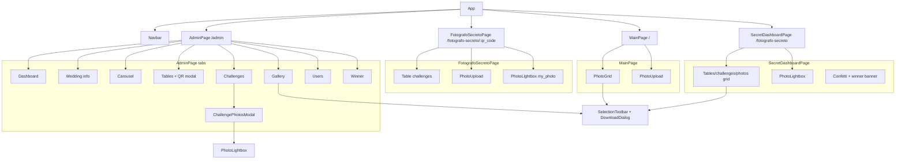

## API

> Interactive docs: **`GET /docs`** (Swagger UI) and `/redoc` (ReDoc), served by FastAPI.

| Method | Route | Auth | Purpose |
|---|---|---|---|
| GET | `/api/wedding-info` | No | Wedding info + winner |
| GET | `/api/carousel` | No | Carousel photos |
| GET | `/api/gallery` | No | Gallery (offset/limit pagination) |
| POST | `/api/gallery/upload` | No (rate limit) | Upload photo + message |
| GET | `/api/gallery/{id}/download` | No | Download one photo |
| POST | `/api/gallery/batch-download` | No | Download several as ZIP (max 100 ids) |
| POST | `/api/guest`, `GET /api/guest/me` | No | Create/query anonymous guest |
| GET | `/api/google`, `/api/google/callback` | No | Google OAuth (`?user_id=X` links, `&drive=1` incremental Drive consent) |
| GET | `/api/drive/status?user_id=X` | No | `{google_linked, drive_ready}` |
| POST | `/api/drive/save-batch` | No (rate limit) | Save up to 100 photos to Drive in the background (`{job_id, total}`) |
| GET | `/api/drive/job/{job_id}?user_id=X` | No | Drive batch status |
| POST | `/api/admin/login`, `/api/logout` | — | Admin session |
| GET | `/api/admin/me` | Admin | Admin session/identity |
| GET | `/api/events` | No | SSE |
| GET | `/api/secret-photographer/dashboard` | No | Public live dashboard |
| GET | `/api/secret-photographer/table/{qr}` | No | Table + challenges + my_photo |
| GET | `/api/secret-photographer/my-table?user_id=X` | No | User's table or `null` |
| POST | `/api/secret-photographer/upload` | No (rate limit) | Upload challenge photo + message |
| POST | `/api/secret-photographer/batch-download` | No | ZIP of challenge photos (`Mesa-XX/…`, max 100 ids) |
| GET | `/api/secret-photographer/challenge/{id}` | No | Challenge detail (blocked) |
| GET | `/api/admin/dashboard` | Admin | Totals (photos, users, tables, challenges, carousel) |
| GET/POST/PUT/DELETE | `/api/admin/tables` | Admin | Table management |
| GET | `/api/admin/tables/{id}/photos` | Admin | Photos per table (winner view) |
| GET/POST/PUT/DELETE | `/api/admin/challenges` | Admin | Challenge management |
| PUT | `/api/admin/challenges/{id}/unlock` | Admin | Unlock challenge for editing/deleting |
| GET | `/api/admin/challenges/{id}/photos` | Admin | Photos of a challenge |
| DELETE | `/api/admin/challenges/{id}/photos/{pid}` | Admin | Delete challenge photo |
| POST/DELETE | `/api/admin/select-winner` | Admin | Pick/remove winner |
| GET/POST/DELETE | `/api/admin/carousel` | Admin | Carousel management |
| PUT | `/api/admin/carousel/reorder` | Admin | Reorder carousel |
| DELETE | `/api/admin/gallery/{id}` | Admin | Delete gallery photo |
| PUT | `/api/admin/wedding-info` | Admin | Edit wedding info/colors |
| GET/POST/DELETE | `/api/admin/users` | Admin | User management (role, alias, table, delete) |
| PATCH | `/api/admin/users/{id}/role` | Admin | Change admin/guest role |
| PUT | `/api/admin/users/{id}` | Admin | Rename alias |
| PATCH | `/api/admin/users/{id}/table` | Admin | Assign/clear table |
| DELETE | `/api/admin/users/{id}?delete_photos=false` | Admin | Delete user; `false` anonymizes photos, `true` deletes them |

## Business rules

- Guests **need no account**: anonymous identity via a server-generated UUID (uuid4) stored in DB and localStorage
- **Google OAuth** (optional) recovers identity across devices; when linked, the alias is replaced by the Google name and profile photo
- Uploads validated by **real MIME type** (byte inspection) + extension; **every image format** (iPhone HEIC/HEIF is converted to JPEG with `exif_transpose`; the original is not kept); max **25 MB**
- Files named with a **UUID** (no collisions); **thumbnails** in a max 150×150 box (aspect ratio preserved)
- **Infinite scroll** pagination (offset/limit)
- **Bulk download by selection** (gallery, admin tab and challenge dashboard): activated by **long-pressing** a photo (~500 ms), deactivated when the selection empties → **single ZIP** (max 100; temp file, deleted after sending) or **individual files** (no limit)
- **Save to Google Drive** (only users with linked Google): incremental `drive.file` consent on first use, per-user refresh token, root folder `Fotos Boda {novio1} y {novio2}` (challenges mirror `Fotografo-Secreto/Mesa-XX`), duplicate skipping, background jobs with polling and toast notifications
- **15 uploads/minute** per user (also for challenges)
- Photos are served by FastAPI (no auth to view)
- Optional **150-character** message on gallery and challenge photos
- Secret Photographer: **1 photo/user/challenge** (unique constraint), max = table participant count; challenges lock when full (admins can unlock to edit/delete)
- A user is assigned to a **table exactly once**; each participant sees **only their own photo** per challenge; viewers see everything on the public dashboard
- **Admins** are `User` rows with `role='admin'` (no separate model); the 3 `.env` emails are re-asserted as admins on every boot; the panel can pre-create users by email and change roles; a Google login with an admin email **merges** any previous guest identity (photos + table)
- Deleting a user can leave photos **anonymous** (`user_id=NULL` → "Anónimo") or **remove** them with their files
- `Miniaturas/` mirrors `Fotos/`; orphan cleanup every 10 s; SQLite in **WAL mode** (no automatic backups)

## Photo directories

```
Fotos/
├── Carrucel/          # Couple's carousel
├── Galeria/           # Guest uploads
└── Fotografo-Secreto/
    ├── Mesa-01/       # QR.png + challenge photos for table 1
    ├── Mesa-02/
    └── ...

Miniaturas/            # Same structure, 150×150 thumbnails
```

## Tests & CI/CD

| Suite | Command | Coverage |
|---|---|---|
| Backend (174) | `cd backend && python -m pytest -q` | Services (validation/thumbnails/HEIC/ZIP/rate-limit), APIs (gallery, auth, admin, secret photographer), Drive and migrations |
| Frontend (77) | `cd frontend && npm test` | utils/api, hooks (`usePhotoSelection`, `useLongPress`) and components |
| Lint/build | `npm run lint` · `npm run build` | oxlint + production build |

- The backend suite is **self-contained**: no `.env` needed and real data is never touched (temp DB/folders). Details in [`tests.md`](tests.md).
- **CI** (`.github/workflows/ci.yml`): PRs to `master`/`main` and pushes to `test/**` → pytest (Python 3.13) + lint/test/build (Node 20).
- **CD** (`.github/workflows/cd.yml`): push to `master` or a `v*` tag → same tests (gating) + build/push of the images to GHCR (`latest`, `sha-…`, semver).

## Technical decisions

| Aspect | Decision |
|---|---|
| State management | React Context |
| HTTP client | Native `fetch` + `api()`/`apiUpload()`/`apiBlob()` helpers |
| Pagination | offset/limit |
| Image processing | Pillow (Python) |
| OAuth | Authlib |
| Google Drive | REST v3 via `httpx` (no SDK) |
| QR codes | `qrcode` (Python) |
| DB migrations | `create_all` + hand-written `ALTER TABLE` in the lifespan (no Alembic) |
| Config | pydantic-settings |
| Realtime | SSE (7 named events) |
| Lightbox | Shared `PhotoLightbox` component |
| Versioning | `vX.Y.Z` tags → versioned GHCR images (rollback via `TAG`) |

## Project structure

```
wedding-photo-manager/
├── backend/                  # FastAPI (app/, tests/, Dockerfile)
│   └── app/
│       ├── routers/          # main, auth, fotografo_secreto, admin, drive, sse
│       ├── services/         # photo_service, drive_service, auth_service, sse_manager…
│       ├── models/  schemas/ # SQLAlchemy models + pydantic schemas
│       └── main.py           # app, lifespan (migrations), static mounts
├── frontend/                 # React + Vite (src/, Dockerfile, Dockerfile.dev, nginx.conf.template)
├── docs/screenshots/         # Screenshots used in this README
├── .github/workflows/        # ci.yml (tests) + cd.yml (GHCR images)
├── docker-compose.yml        # Deployment: pulls GHCR images
├── docker-compose.dev.yml    # Development: builds from source
├── tests.md                  # Test-suite guide (Spanish)
├── AGENTS.md                 # Guide for AI coding agents
└── README.es.md              # Spanish version of this README
```

At runtime `Fotos/`, `Miniaturas/` and `data/` are created (git-ignored).

## Contributing

Contributions are welcome!

1. Open an **issue** to discuss the change (bugs, ideas, questions).
2. **Fork** the repo and create a branch (`feature/...` or `test/...`).
3. Make sure everything is green before the PR:
   ```bash
   (cd backend && python -m pytest -q) && (cd frontend && npm test && npm run lint)
   ```
4. Open a **PR against `master`**; CI must pass.
5. If behavior changes, keep `README.md`, `README.es.md` and `tests.md` in sync.

Commit messages: short and descriptive.

## License

Released under the [MIT License](LICENSE).

## Author

[@juniornff](https://github.com/juniornff)
