# Wedding Photo Manager

Aplicación web para gestionar fotos de bodas: subida, visualización y descarga por parte de los invitados, más el módulo interactivo **Fotógrafo Secreto**.

---

## Stack tecnológico

| Capa | Tecnología |
|---|---|
| Backend | FastAPI + SQLAlchemy (async) + SQLite (WAL mode) |
| Backend libs | Pillow (thumbnails), Authlib (OAuth), qrcode (QR gen), pydantic-settings (config) |
| Frontend | React 19 + Vite + TailwindCSS v4 + React Router |
| Frontend HTTP | fetch nativo + React Context (sin Redux/axios) |
| Tiempo real | Server-Sent Events (SSE) |
| Almacenamiento | Local filesystem (`Fotos/`, `Miniaturas/`), SQLite en `data/wedding.db` |
| Autenticación | Google OAuth + UUID anónimo (localStorage) |
| Despliegue | Docker Compose (backend + frontend); Caddy aparte |
| Testing | Sin suites por el momento |

---

## Arquitectura del sistema

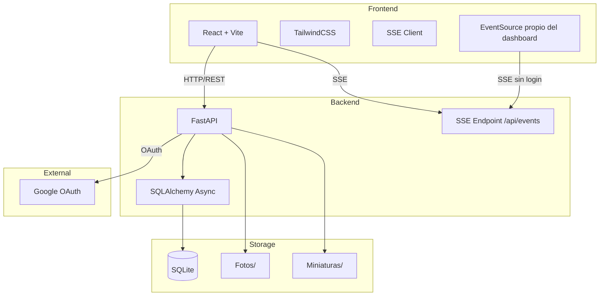

---

## Módulos

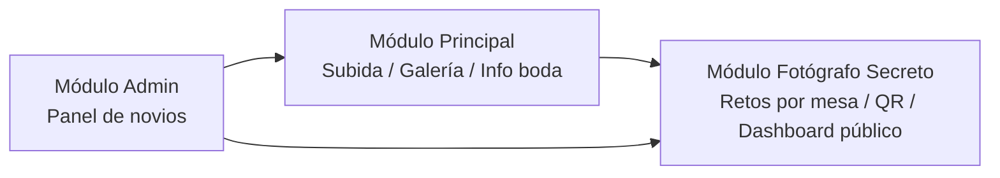

### Módulo Principal
- Información de la boda (nombres, fecha)
- Carrusel de fotos de los novios (`Fotos/Carrucel/`)
- Galería de fotos subidas por invitados (`Fotos/Galeria/`) — con mensaje opcional (150 caracteres)
- Botón flotante para subir fotos
- Visualización en vivo vía SSE (`new_photo`, `gallery_photo_deleted`, `info_updated`, `carousel_updated`)

### Módulo Fotógrafo Secreto
- Cada mesa tiene un QR único (generado como PNG estático en `Fotos/Fotografo-Secreto/Mesa-XX/QR.png`)
- Retos por mesa (creados desde el panel admin); 1 foto por participante por reto, máximo = nº de participantes de la mesa
- El usuario se asigna a una mesa al escanear el QR (una sola vez, error si reasigna)
- Mensaje opcional (150 caracteres) también en las fotos de reto
- Cada participante ve su **propia foto** por reto (badge "✓ Tu foto subida" + lightbox)
- **Dashboard público** (`/fotografo-secreto`): mesas → retos → fotos con autor, progreso y ganador en vivo, animación de confetti al elegir ganador
- Admin elige *(y puede deseleccionar)* ganador manualmente

### Módulo Admin
- Gestionar carrusel, info de boda, esquema de colores
- Administrar mesas y retos
- Ver/descargar/eliminar fotos de cada reto
- Elegir o quitar la mesa ganadora del Fotógrafo Secreto

---

## Diagrama Entidad-Relación (Base de Datos)

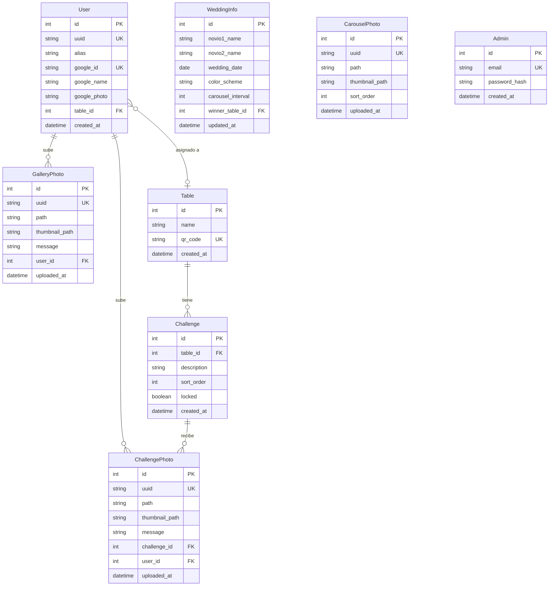

> Nota: `Table.name` no es único en la BD (solo `qr_code` lo es). Los cambios de esquema se aplican con `Base.metadata.create_all` + `ALTER TABLE` manuales en el lifespan (sin Alembic).

---

## Diagrama de Casos de Uso

```mermaid
graph TB
    INVITADO[Invitado]
    NOVIOS[Novios]
    GOOGLE[Usuario Google OAuth]
    ESPECTADOR[Invitado espectador]

    subgraph "Módulo Principal"
        UC1[Ver info boda]
        UC2[Ver carrusel]
        UC3[Subir foto + mensaje]
        UC4[Ver galería en vivo]
        UC5[Descargar foto]
    end

    subgraph "Fotógrafo Secreto"
        UC6[Escanear QR mesa]
        UC7[Ver retos de mesa]
        UC8[Subir foto + mensaje para reto]
        UC9[Ver mi propia foto por reto]
        UC10[Ver tablero público en vivo]
    end

    subgraph "Admin"
        UC11[Gestionar carrusel]
        UC12[Editar info boda]
        UC13[Cambiar colores]
        UC14[Administrar mesas]
        UC15[Crear/editar/desbloquear retos]
        UC16[Gestionar fotos de retos]
        UC17[Elegir mesa ganadora]
        UC18[Quitar mesa ganadora]
        UC19[Moderar galería]
    end

    INVITADO --> UC1
    INVITADO --> UC2
    INVITADO --> UC3
    INVITADO --> UC4
    INVITADO --> UC5
    INVITADO --> UC6
    INVITADO --> UC7
    INVITADO --> UC8
    INVITADO --> UC9

    ESPECTADOR --> UC10

    NOVIOS --> UC11
    NOVIOS --> UC12
    NOVIOS --> UC13
    NOVIOS --> UC14
    NOVIOS --> UC15
    NOVIOS --> UC16
    NOVIOS --> UC17
    NOVIOS --> UC18
    NOVIOS --> UC19

    GOOGLE -->|Recupera identidad| UC3
    GOOGLE -->|Recupera identidad| UC8
```

---

## Diagramas de Secuencia

### Flujo: Acceso de invitado y subida de foto

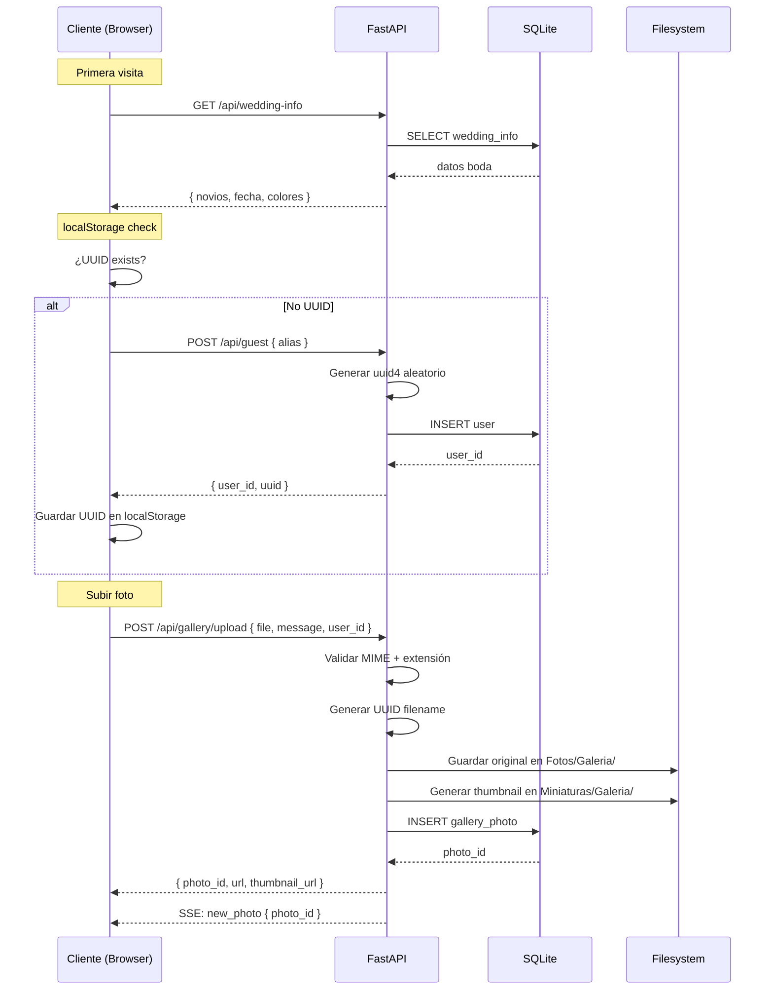

### Flujo: Fotógrafo Secreto (participante)

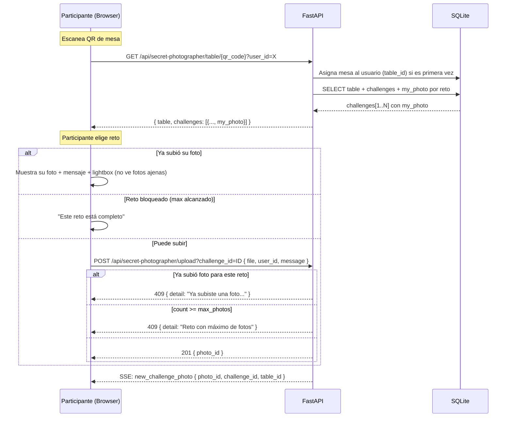

### Flujo: Dashboard público (espectador no participante)

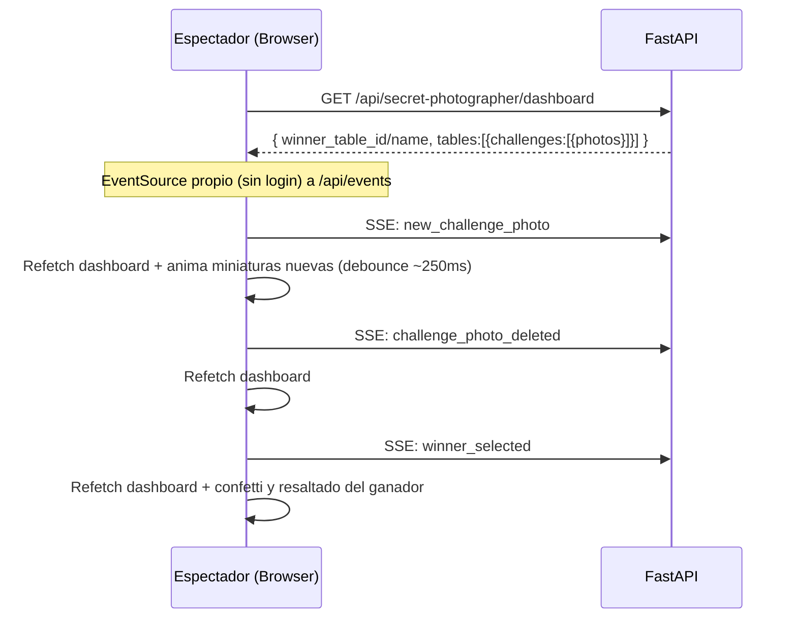

### Flujo: Elección de ganador (Admin)


---

## Diagrama de Estados

### Ciclo de vida de una foto

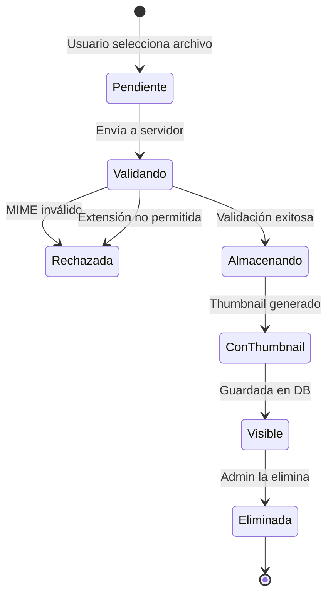

### Ciclo de vida del juego Fotógrafo Secreto

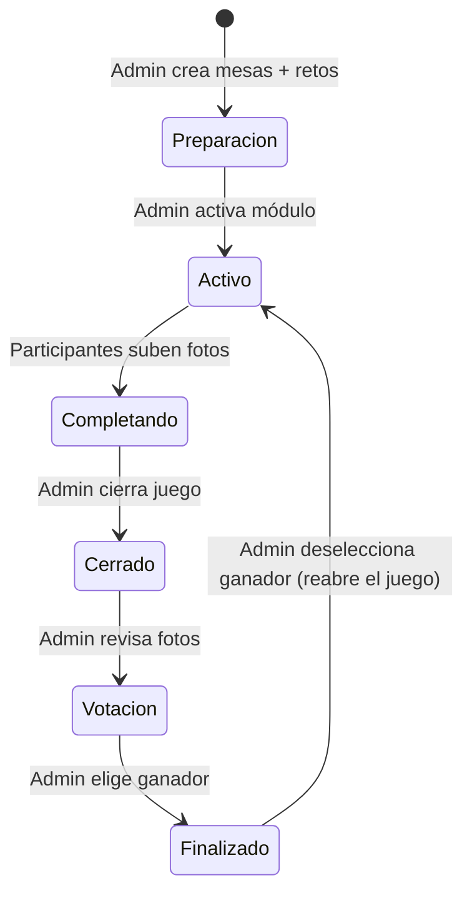

---

## Diagrama de Componentes del Backend

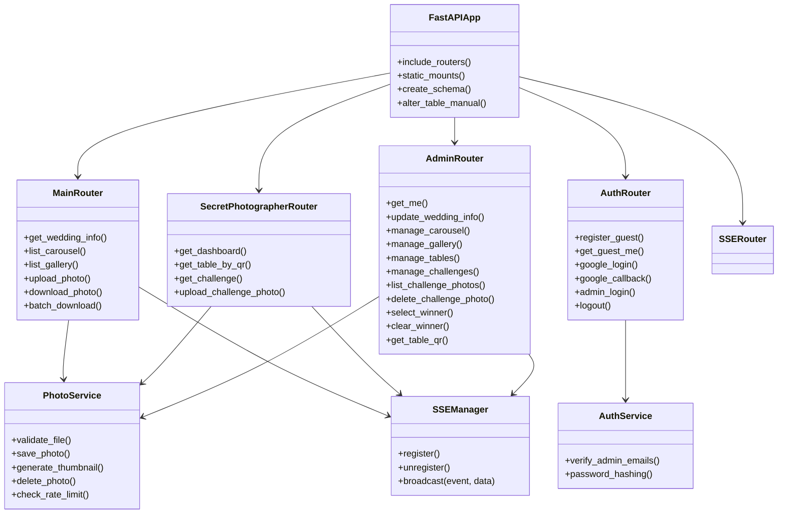

### Eventos SSE emitidos por el backend

| Evento | Emisor | Payload |
|---|---|---|
| `new_photo` | `POST /api/gallery/upload` | `{ photo_id }` |
| `gallery_photo_deleted` | `DELETE /api/admin/gallery/{id}` | `{ photo_id }` |
| `new_challenge_photo` | `POST /api/secret-photographer/upload` | `{ photo_id, challenge_id, table_id }` |
| `challenge_photo_deleted` | `DELETE /api/admin/challenges/{cid}/photos/{pid}` | `{ photo_id, challenge_id }` |
| `carousel_updated` | Admin carrusel (upload/delete/reorder) | `{}` |
| `info_updated` | `PUT /api/admin/wedding-info` | `{ novios, fecha, colores, ... }` |
| `winner_selected` | Admin seleccionar/quitar ganador | `{ table_id }` o `{ table_id: null }` |

> El dashboard público abre su propio `EventSource` a `/api/events` (endpoint sin auth) para `new_challenge_photo`, `challenge_photo_deleted` y `winner_selected`.

---

## Árbol de rutas y componentes del Frontend

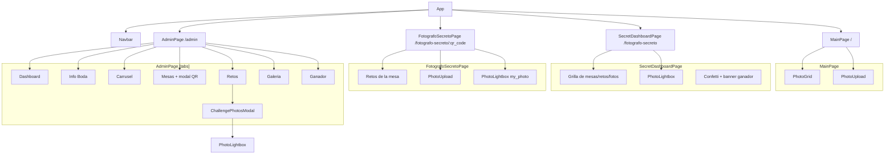

---

## Directorios de fotos

```
Fotos/
├── Carrucel/          # Carrusel de los novios
├── Galeria/           # Fotos subidas por invitados
└── Fotografo-Secreto/
    ├── Mesa-01/       # Fotos de mesa 1 (QR.png + fotos de retos)
    ├── Mesa-02/       # Fotos de mesa 2
    └── ...

Miniaturas/
├── Carrucel/
├── Galeria/
└── Fotografo-Secreto/
    └── Mesa-XX/
```

---

## API (resumen de endpoints)

| Método | Ruta | Auth | Uso |
|---|---|---|---|
| GET | `/api/wedding-info` | No | Info boda + ganador |
| GET | `/api/carousel` | No | Fotos de carrusel |
| GET | `/api/gallery` | No | Galería (paginación offset/limit) |
| POST | `/api/gallery/upload` | No (rate limit) | Subir foto + mensaje |
| GET | `/api/gallery/{id}/download` | No | Descargar una foto |
| POST | `/api/gallery/batch-download` | No | Descargar varias |
| GET | `/api/guest`, `/api/guest/me` | No | Alta/consulta de invitado anónimo |
| GET | `/api/google`, `/api/google/callback` | No | OAuth Google |
| POST | `/api/admin/login`, `/api/logout` | — | Sesión admin |
| GET | `/api/events` | No | SSE |
| GET | `/api/secret-photographer/dashboard` | No | Tablero público en vivo |
| GET | `/api/secret-photographer/table/{qr}` | No | Mesa + retos + my_photo |
| POST | `/api/secret-photographer/upload` | No (rate limit) | Subir foto de reto + mensaje |
| GET | `/api/secret-photographer/challenge/{id}` | No | Detalle reto (blocked) |
| GET | `/api/admin/tables`, `POST/PUT/DELETE` | Admin | Gestión mesas |
| GET | `/api/admin/tables/{id}/photos` | Admin | Fotos por mesa (vista ganador) |
| GET | `/api/admin/tables/{id}/qr` | Admin | Descargar QR |
| GET/POST/PUT/DELETE | `/api/admin/challenges` | Admin | Gestión retos |
| GET | `/api/admin/challenges/{id}/photos` | Admin | Fotos de un reto |
| DELETE | `/api/admin/challenges/{id}/photos/{pid}` | Admin | Borrar foto de reto |
| POST/DELETE | `/api/admin/select-winner` | Admin | Elegir/quitar ganador |
| GET/POST/DELETE | `/api/admin/carousel`, `/gallery` | Admin | Gestión carrusel/galería |
| PUT | `/api/admin/wedding-info` | Admin | Editar info boda/colores |

---

## Reglas de negocio clave

- Los invitados **no necesitan login** — se identifican por UUID en localStorage
- El **UUID lo genera el servidor** (`uuid4` aleatorio), se guarda en DB y se devuelve al cliente
- Google OAuth permite **recuperar identidad** entre dispositivos; al vincularse, el alias se reemplaza por el nombre de Google y se muestra su foto de perfil
- Solo imágenes (validación por **MIME type real** inspeccionando bytes + extensión) — **todos los formatos**, máx **25 MB**
- Nombres de archivo con **UUID** para evitar colisiones
- **Miniatura 150×150px** manteniendo aspect ratio
- **Paginación infinita** con offset/limit
- **15 subidas/minuto** por usuario (rate limit) — también en retos
- Las fotos se sirven **a través de FastAPI** (sin autenticación para visualizar)
- Mensaje opcional (150 caracteres) en galería **y** en fotos de retos
- Fotógrafo Secreto: **1 foto/usuario/reto** (UniqueConstraint `challenge_id+user_id`), máx = nº participantes de la mesa
- Un usuario se asigna a una **mesa una sola vez** (campo `table_id` en User)
- Los retos se bloquean al alcanzar el nº de participantes; admin puede desbloquear para editar/eliminar
- Cada participante ve **solo su propia foto** por reto; los espectadores ven **todas** en el dashboard público
- Dashboard público **en vivo sin login** (EventSource propio); confetti + resaltado al elegir ganador
- Admin puede **seleccionar y deseleccionar** el ganador; se notifica por SSE
- **Admin**: Google OAuth + session cookies + verificación contra emails en `.env`; **admin inicial** desde `.env`
- `Miniaturas/` replica exactamente la estructura de `Fotos/`
- **Limpieza de archivos huérfanos** cada 10s (`ORPHAN_CLEANUP_INTERVAL`)
- **SQLite con WAL mode** para concurrencia; sin backups automáticos

---

## Variables de entorno (`.env`)

El archivo `.env` de la raíz (no versionado) es la **única fuente de secretos**. `.env.example` fue **eliminado del repo** (no se usa en ningún punto del código).

**Carga** (`backend/app/config.py`): `Settings` lee `env_file` desde dos candidatos (los faltantes se ignoran):
1. `backend/.env` — en el contenedor es `/app/.env` (el compose monta `./.env` → `/app/.env`)
2. ruta raíz del repo — hace funcionar los runs locales fuera de Docker

Las variables de entorno reales tienen prioridad sobre los dotenv; `extra="ignore"` tolera claves desconocidas.

| Variable | Uso |
|---|---|
| `ADMIN_EMAIL` | Email del admin (OAuth + login inicial) |
| `ADMIN_PASSWORD` | Password del admin inicial |
| `GOOGLE_CLIENT_ID` | Google OAuth client ID |
| `GOOGLE_CLIENT_SECRET` | Google OAuth client secret |
| `SECRET_KEY` | Clave para session cookies |
| `NOVIO_EMAIL` / `NOVIA_EMAIL` | Presentes en el `.env`, el código actual no las lee |

Opcionales (defaults en `Settings`, no hace falta ponerlas en `.env`): `ORPHAN_CLEANUP_INTERVAL=10`, `FRONTEND_URL=http://localhost:5173`, `MAX_UPLOAD_SIZE=25`, `RATE_LIMIT_PER_MINUTE=15`, `HOST=0.0.0.0`, `PORT=8000`, `DATABASE_URL`, `UPLOAD_DIR=Fotos`, `THUMBNAILS_DIR=Miniaturas`.

---

## Puesta en marcha

- `docker compose up --build` levanta backend y frontend.
- Host: backend publicado en **`localhost:8001`** (→ contenedor `:8000`), frontend en `localhost:5173`.
- `VITE_API_URL=http://localhost:8001` se inyecta como **build-time ARG** (si cambia el puerto, reconstruir con `docker compose build --build-arg VITE_API_URL=...`).
- Para correr el backend local fuera de Docker: `uvicorn app.main:app --reload` desde `backend/` (lee el `.env` raíz).
- Dev frontend: `npm run dev` en `frontend/` (Vite proxya `/api` → `http://localhost:8000`).

---

## Decisiones técnicas adoptadas

| Aspecto | Decisión |
|---|---|
| Gestión de estado | React Context |
| Cliente HTTP | `fetch` nativo + helpers `api()`/`apiUpload()` |
| Paginación | offset/limit |
| Procesamiento de imágenes | Pillow (Python) |
| OAuth | Authlib |
| Generación de QR | `qrcode` (Python) |
| Migraciones BD | `Base.metadata.create_all()` + `ALTER TABLE` manuales en el lifespan (sin Alembic) |
| Config | pydantic-settings |
| Tiempo real | SSE (`new_photo`, `new_challenge_photo`, `challenge_photo_deleted`, `gallery_photo_deleted`, `carousel_updated`, `info_updated`, `winner_selected`) |
| Visualización de fotos | Componente compartido `PhotoLightbox` (lightbox + descarga, opcional eliminar) |
| Entorno dev | `docker compose up --build` |
| Python | Última versión estable |
| Node | Última versión estable |